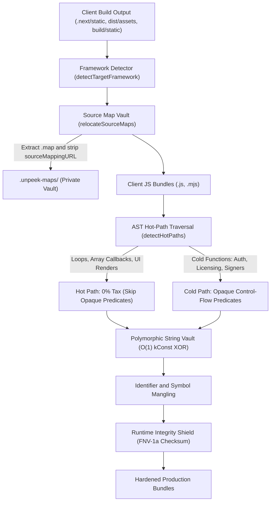

<p align="center">
  <picture>
    <source media="(prefers-color-scheme: dark)" srcset="https://raw.githubusercontent.com/Woffluon/unpeek/main/assets/banner-dark.svg">
    <source media="(prefers-color-scheme: light)" srcset="https://raw.githubusercontent.com/Woffluon/unpeek/main/assets/banner-light.svg">
    
  </picture>
</p>

# unpeek

**Nothing to peek at. Nothing to slow down.**

Zero-config, call-graph-aware client-side JavaScript protection and runtime anti-tamper toolkit with <2% CPU overhead and <15% Gzip budget.

[](LICENSE)
[](packages/unpeek/benchmarks/overhead.bench.ts)
[](packages/unpeek/benchmarks/overhead.bench.ts)
[](https://woffluon.github.io/unpeek)
[](https://woffluon.github.io/unpeek/docs)

English | [Türkçe](./README.tr.md) · [Interactive Showcase](https://woffluon.github.io/unpeek) · [Documentation](https://woffluon.github.io/unpeek/docs) · [Agent Architecture Guide](./AGENTS.md) · [AI Skill](./skills/unpeek/SKILL.md)

---

## Why unpeek?

Deploying a web application built with Next.js, Vite, or Webpack exposes client-side business logic, internal API endpoints, feature flags, and proprietary algorithms to anyone who opens browser developer tools or runs automated AST deobfuscators like `webcrack` or `synchrony`.

Existing tools force an uncomfortable trade-off:
- **Standard minifiers (`esbuild`, `SWC`, `Terser`):** Compress whitespace and shorten variable names, leaving string literals, endpoint URLs, and control flow readable after a single click on the DevTools Pretty-Print (`{}`) button.
- **Legacy AST obfuscators (`javascript-obfuscator`):** Apply indiscriminate control-flow flattening, `eval` traps, and eager string-array rotation across every function in the bundle. This inflates bundle sizes by 40% to 300%, degrades V8 TurboFan JIT inlining in 60fps UI rendering loops, and triggers browser freezes.

`unpeek` resolves this trade-off by combining static call-graph analysis with polymorphic compile-time encryption:

| Capability | Standard Minifiers (`Terser` / `SWC`) | Legacy AST Obfuscators | `unpeek` |
| :--- | :--- | :--- | :--- |
| **Runtime CPU Overhead** | ~0% | 15% to 85% (throttles UI loops) | **< 2.0%** (Call-Graph Hot-Path Exemption) |
| **Gzip Bundle Growth** | 0% (Baseline) | +45% to +300% | **< 15%** (O(1) `kConst` String Vault) |
| **String & Endpoint Encryption** | Plaintext in bundle | Eager array rotation (high CPU) | **Polymorphic Period-2 XOR + O(1) `kConst` Vault** |
| **DevTools Pretty-Print (`{}`) Defense** | None | `debugger` infinite loops (easily bypassed) | **`Function.prototype.toString()` FNV-1a Integrity** |
| **Source Map Isolation** | Manual CI scripts | Manual configuration | **Automatic `.unpeek-maps/` Vault + Comment Strip** |
| **Static Deobfuscator Resistance** | None | Fixed templates (fingerprinted by deobfuscators) | **Per-Build Polymorphic AST Seed** |
| **SSR / Next.js Compatibility** | Native | Frequently breaks server hydration | **Client-Only Auto-Detection + SSR Guard** |

### Core Architecture



1. **Call-Graph Hot-Path Exemption (`<2%` CPU Budget)**
   Before modifying an AST node, [`detectHotPaths`](packages/unpeek/src/ast/index.ts) traverses the file call graph bidirectionally. Functions containing loops (`for`, `while`, `do-while`, `for-of`), array higher-order callbacks (`.map`, `.filter`, `.reduce`, `.forEach`), `requestAnimationFrame` tickers, React/UI render components (`useState`, `useEffect`, `createElement`), and all helper callees invoked from hot loops are flagged as hot paths. `unpeek` exempts hot loops and their callees from both opaque control-flow predicates and string vault rewriting, while protecting cold functions (such as license checks, request signers, and auth validators). V8 JIT optimization inside hot loops remains untouched.
2. **O(1) Const-Array String Vault & Tamper Entanglement (`<15%` Gzip Budget)**
   Cold string literals (`minStringLength >= 4`) are encrypted at build time with a period-2 polymorphic XOR stream cipher keyed by a per-build 32-bit seed that preserves LZ77/Gzip compressibility. At module initialization, the injected `const _uC` vault decodes strings once into a V8 `kConst` array slot so every subsequent read resolves in O(1) constant time via direct array indexing, while dual-entangling the XOR key with both the runtime integrity state (`String.prototype._u`) and self-verifying decoder formatting (`/\n/.test(f)`).
3. **Self-Defending `Function.prototype.toString()` Integrity and Passive Deterrent**
   When an analyst formats a protected chunk using DevTools Pretty-Print (`{}`) or edits a branch instruction in the Sources panel, the formatted source alters `Function.prototype.toString()`. [`verifyCodeIntegrity`](packages/unpeek/src/runtime/index.ts) validates a seeded 32-bit FNV-1a checksum against the function source representation with zero false positives on untouched minified code, triggering gradual state degradation (`deterrentMode: 'gradual'`) rather than an obvious crash point that attackers can patch out.
4. **Automatic Source Map Vault (`.unpeek-maps/`)**
   Leaving `.js.map` files in a public build directory reconstructs your original TypeScript project tree inside DevTools. [`protectProject`](packages/unpeek/src/cli/protect.ts) extracts `.map` files from your public build directory into a private `.unpeek-maps/` folder and strips `//# sourceMappingURL=` comments from every client bundle so you can upload maps to Sentry or Datadog without serving them to end users.

---

## Quick Start

### 1. Project Setup (`npx unpeek init`)

Run the initializer from your project root (Next.js, Vite, Webpack, or vanilla JS):

```bash
npx unpeek init
```

This command performs three setup actions:
1. Detects your framework (`nextjs`, `vite`, `webpack`, or `vanilla`) from `package.json` and build config files.
2. Adds `"postbuild": "unpeek protect"` to your `package.json` scripts so every production build is automatically protected.
3. Appends `.unpeek-maps/` to `.gitignore` so extracted source maps stay out of version control.

### 2. CLI Usage (`unpeek protect`)

Install `unpeek` as a development dependency and run it directly in CI/CD or local builds:

```bash
npm install -D unpeek
npx unpeek protect
```

#### CLI Commands & Options

| Command / Flag | Description | Default |
| :--- | :--- | :--- |
| `init [--dry-run]` | Automatically detect project framework, configure `postbuild` script, and create `.unpeek-maps/` vault | |
| `protect` | Protect production client bundles in-place (default command) | |
| `--out-dir <path>` | Explicit client output directory override (e.g., `dist/assets`, `.next/static/chunks`) | Auto-detected from project framework |
| `--seed <number>` | Deterministic 32-bit polymorphic build seed | Random per build |
| `--passive` | Use passive deterrent mode instead of gradual state degradation | Default: gradual degradation |
| `--no-maps` | Permanently delete `.map` files instead of moving them to `.unpeek-maps/` | Moves to `.unpeek-maps/` |
| `--min-string-length <num>` | Minimum string length for O(1) `kConst` encryption vault | `4` |
| `--private-maps-dir <dir>` | Directory to store vaulted private source maps | `.unpeek-maps` |
| `--no-shield` | Do not inject runtime anti-tamper deterrent shield | Shield injected into entry chunks |
| `-h, --help` | Show CLI help message | |
| `-v, --version` | Show CLI version number | |

> [!NOTE]
> Programmatic execution through `protectProject(options)` supports additional fine-grained options, including `minStringLength`, `privateMapsDir`, `injectRuntimeShield`, and `cwd`.

> [!IMPORTANT]
> **CommonJS Users (Dynamic `import()`):**
> Because `unpeek` is distributed with native ECMAScript Modules (`"type": "module"`), in CommonJS environments (`.cjs` files or `require()` scripts) load `unpeek` using dynamic `import()`:
> ```javascript
> // CommonJS (next.config.js / webpack.config.js / scripts)
> const unpeek = (await import('unpeek/unplugin')).default;
> const { protectProject, transformJavaScript } = await import('unpeek');
> ```

### 3. Universal Bundler Plugin (`unpeek/unplugin`)

For in-memory chunk transformations during the bundler build lifecycle rather than a post-build CLI pass, use [`unpeek/unplugin`](packages/unpeek/src/bundler/unplugin.ts):

#### Vite (`vite.config.ts`)

```ts
import { defineConfig } from 'vite';
import unpeek from 'unpeek/unplugin';

export default defineConfig({
  plugins: [
    unpeek.vite({
      deterrentMode: 'gradual',
    }),
  ],
});
```

#### Next.js (`next.config.mjs`)

Scope the plugin to client bundles (`!isServer`) so Node.js server chunks keep their native stack traces:

```js
import unpeek from 'unpeek/unplugin';

/** @type {import('next').NextConfig} */
const nextConfig = {
  webpack(config, { dev, isServer }) {
    if (!dev && !isServer) {
      config.plugins.push(
        unpeek.webpack({
          deterrentMode: 'gradual',
        })
      );
    }
    return config;
  },
};

export default nextConfig;
```

#### Programmatic API

```ts
import { transformJavaScript, protectProject } from 'unpeek';

// Transform an individual JavaScript string in memory
const result = transformJavaScript(sourceCode, {
  seed: 0x7f3a91,
  minStringLength: 4,
  injectRuntimeShield: true,
  deterrentMode: 'gradual',
});

console.log(result.hotPathReport);
// { totalFunctions: 12, hotFunctionsSkipped: ['renderLoop'], coldFunctionsProtected: ['signRequest'] }

// Or protect an entire build directory
const summary = await protectProject({
  cwd: process.cwd(),
  keepPrivateMaps: true,
  privateMapsDir: '.unpeek-maps',
});
```

---

## `.unpeek-maps/` Source Map Vault & Sentry Workflow

When `keepPrivateMaps` is enabled (the default), `unpeek` relocates all `.js.map` files from your public output directory into `.unpeek-maps/` while preserving relative filenames, and strips `//# sourceMappingURL=` directives from public `.js` chunks.

To retain full stack-trace symbolication in production error trackers:

```bash
# 1. Build your app and run unpeek (automatically triggered if wired via postbuild)
npm run build

# 2. Upload the private source maps from .unpeek-maps/ to Sentry or Datadog
npx @sentry/cli sourcemaps upload .unpeek-maps --release="$GIT_COMMIT_SHA"

# 3. Deploy your public build folder (.next/, dist/, or build/)
```

---

## AI Coding Agent Integration

`unpeek` ships with an official AI Agent Skill ([`skills/unpeek/SKILL.md`](skills/unpeek/SKILL.md)) following the open Vercel Agent Skills specification and Agent Skills Discovery Optimization (SDO) standards. Installing this skill equips coding agents (Claude Code, Cursor, OpenAI Codex, Gemini CLI, GitHub Copilot, OpenCode) with deep domain knowledge for protecting client-side bundles, preserving hot-path performance budgets (<2% CPU, <15% Gzip), guarding SSR boundaries, and managing `.unpeek-maps/` in CI/CD pipelines.

### Skill Installation

#### 1. Standard Installation (Vercel Agent Skills CLI)

Install the skill directly into your project or configured agent environment:

```bash
npx skills add Woffluon/unpeek
```

#### 2. Local Repository Installation

When developing or testing directly within the `unpeek` repository:

```bash
npx skills add .
```

#### 3. Multi-Agent Targeting & Global Installation

Install globally across multiple coding agents without interactive confirmation:

```bash
npx skills add Woffluon/unpeek --agent claude-code codex cursor gemini-cli github-copilot opencode --global --yes
```

#### 4. Manual / Direct Copy Fallback

You can also copy the skill definition manually into project-level or global agent skill directories:

```bash
# Project-scoped (.agents/skills/unpeek/SKILL.md)
mkdir -p .agents/skills/unpeek
curl -fsSL https://raw.githubusercontent.com/Woffluon/unpeek/main/skills/unpeek/SKILL.md \
  -o .agents/skills/unpeek/SKILL.md

# Global agent directories (Antigravity / Gemini CLI / Claude Code)
mkdir -p ~/.agents/skills/unpeek
curl -fsSL https://raw.githubusercontent.com/Woffluon/unpeek/main/skills/unpeek/SKILL.md \
  -o ~/.agents/skills/unpeek/SKILL.md
```

### Agent Trigger Example

Once installed, invoke the skill directly in any agent session using the `$unpeek` prompt:

```text
$unpeek Protect this build with passive telemetry and seed 0x7f4a2c.
```

### Token-Optimized Modular References (`skills/unpeek/references/`)

To conserve agent context windows and eliminate unnecessary token consumption, the primary [`skills/unpeek/SKILL.md`](skills/unpeek/SKILL.md) remains concise while delegating specialized guidance to on-demand modular reference documents in `skills/unpeek/references/`:

- **`quickstart.md`**: Immediate setup, zero-config postbuild wiring, and 3-step verification loops.
- **`frameworks.md`**: Bundler configurations and SSR client boundaries (Next.js, Vite, Webpack, Rollup).
- **`architecture.md`**: Acorn AST parsing, transitive call-graph hot-path exemption, and FNV-1a checksums.
- **`sourcemaps.md`**: `.unpeek-maps/` vault isolation, CI pipelines, and Sentry/Datadog symbol uploads.
- **`api.md`**: CLI flags, programmatic Node.js methods (`protectProject`, `transformJavaScript`), and TypeScript interfaces.
- **`recipes.md`**: Production hardening recipes, deterministic CI seeds, and passive telemetry troubleshooting.

Agents read only the relevant reference file on-demand, preventing context bloat.

---

## Verification, Testing & Benchmarks

This monorepo is managed with `pnpm` and verified against strict semantic equivalence, deobfuscation resistance, and runtime overhead budgets:

```bash
# Install workspace dependencies
pnpm install

# Run unit and reverse-engineering resistance test suites (Vitest)
pnpm test

# Run unit tests with V8 code coverage report
pnpm --filter unpeek run test:coverage

# Run the V8 VM CPU overhead (<2%) and Gzip delta (<15%) benchmark
pnpm bench

# Run strict TypeScript typechecking across packages/unpeek and apps/web
pnpm typecheck

# Build the core package and static interactive web playground
pnpm build
```

### Monorepo Scripts & Release Integrity

```bash
# Verify Conventional Commit version calculation
powershell -File scripts/test-versioning.ps1

# Validate release readiness against planned commit message
powershell -File scripts/validate-version.ps1 -Message "fix: description"

# Stage release artifacts and compute SHA-256 manifests
powershell -File scripts/stage-release.ps1
```

### Benchmark Output Reference ([`packages/unpeek/benchmarks/overhead.bench.ts`](packages/unpeek/benchmarks/overhead.bench.ts))

- **Build / Transform Time:** `< 3000 ms`
- **Gzip Size Delta:** `< 15%` on production application bundles
- **Runtime CPU Overhead:** `< 2.00%` (interleaved multi-round V8 JIT benchmark)
- **Plaintext Leak Rate:** `0%` for string literals meeting `minStringLength`

## License

Released under the [MIT License](./LICENSE).
