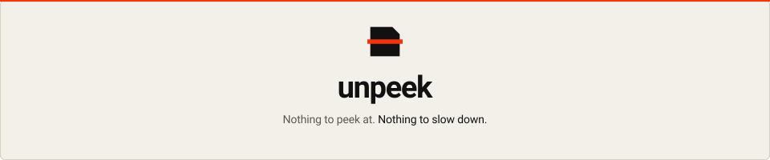
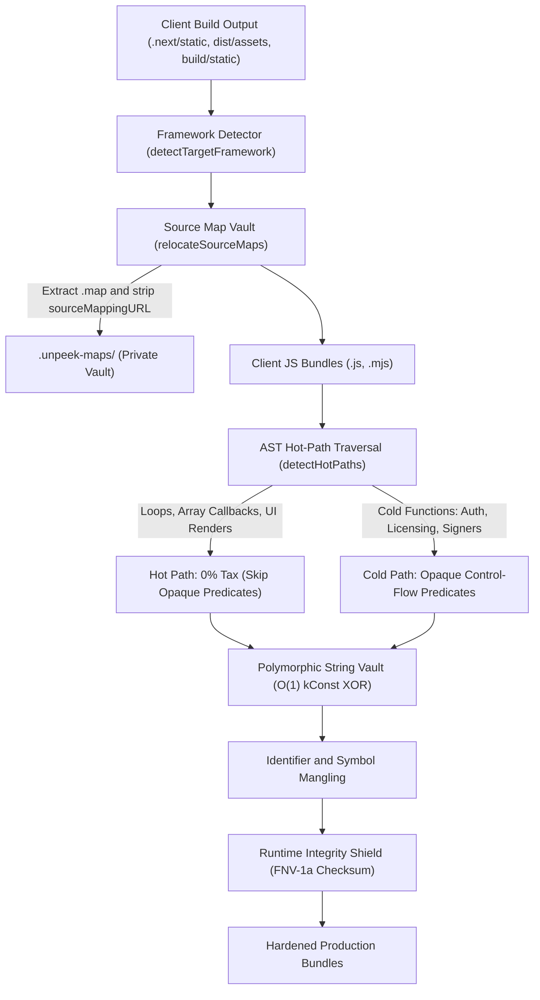

<p align="center">
  <picture>
    <source media="(prefers-color-scheme: dark)" srcset="https://raw.githubusercontent.com/Woffluon/unpeek/main/assets/banner-dark.svg">
    <source media="(prefers-color-scheme: light)" srcset="https://raw.githubusercontent.com/Woffluon/unpeek/main/assets/banner-light.svg">
    
  </picture>
</p>

# unpeek

**Nothing to peek at. Nothing to slow down.**

Zero-config, call-graph-aware client-side JavaScript protection and runtime anti-tamper toolkit with <2% CPU overhead and <15% Gzip budget.

[](LICENSE)
[](packages/unpeek/benchmarks/overhead.bench.ts)
[](packages/unpeek/benchmarks/overhead.bench.ts)
[](https://woffluon.github.io/unpeek)
[](https://woffluon.github.io/unpeek/docs)

English | [Türkçe](./README.tr.md) · [Interactive Showcase](https://woffluon.github.io/unpeek) · [Documentation](https://woffluon.github.io/unpeek/docs) · [Agent Architecture Guide](./AGENTS.md) · [AI Skill](./skills/unpeek/SKILL.md)

---

## Why unpeek?

Deploying a web application built with Next.js, Vite, or Webpack exposes client-side business logic, internal API endpoints, feature flags, and proprietary algorithms to anyone who opens browser developer tools or runs automated AST deobfuscators like `webcrack` or `synchrony`.

Existing tools force an uncomfortable trade-off:
- **Standard minifiers (`esbuild`, `SWC`, `Terser`):** Compress whitespace and shorten variable names, leaving string literals, endpoint URLs, and control flow readable after a single click on the DevTools Pretty-Print (`{}`) button.
- **Legacy AST obfuscators (`javascript-obfuscator`):** Apply indiscriminate control-flow flattening, `eval` traps, and eager string-array rotation across every function in the bundle. This inflates bundle sizes by 40% to 300%, degrades V8 TurboFan JIT inlining in 60fps UI rendering loops, and triggers browser freezes.

`unpeek` resolves this trade-off by combining static call-graph analysis with polymorphic compile-time encryption:

| Capability | Standard Minifiers (`Terser` / `SWC`) | Legacy AST Obfuscators | `unpeek` |
| :--- | :--- | :--- | :--- |
| **Runtime CPU Overhead** | ~0% | 15% to 85% (throttles UI loops) | **< 2.0%** (Call-Graph Hot-Path Exemption) |
| **Gzip Bundle Growth** | 0% (Baseline) | +45% to +300% | **< 15%** (O(1) `kConst` String Vault) |
| **String & Endpoint Encryption** | Plaintext in bundle | Eager array rotation (high CPU) | **Polymorphic Period-2 XOR + O(1) `kConst` Vault** |
| **DevTools Pretty-Print (`{}`) Defense** | None | `debugger` infinite loops (easily bypassed) | **`Function.prototype.toString()` FNV-1a Integrity** |
| **Source Map Isolation** | Manual CI scripts | Manual configuration | **Automatic `.unpeek-maps/` Vault + Comment Strip** |
| **Static Deobfuscator Resistance** | None | Fixed templates (fingerprinted by deobfuscators) | **Per-Build Polymorphic AST Seed** |
| **SSR / Next.js Compatibility** | Native | Frequently breaks server hydration | **Client-Only Auto-Detection + SSR Guard** |

### Core Architecture



1. **Call-Graph Hot-Path Exemption (`<2%` CPU Budget)**
   Before modifying an AST node, [`detectHotPaths`](packages/unpeek/src/ast/index.ts) traverses the file call graph bidirectionally. Functions containing loops (`for`, `while`, `do-while`, `for-of`), array higher-order callbacks (`.map`, `.filter`, `.reduce`, `.forEach`), `requestAnimationFrame` tickers, React/UI render components (PascalCase components carrying a JSX `createElement`/`_jsx` or `use*` hook/HOC UI signal), and all helper callees invoked from hot loops are flagged as hot paths. `unpeek` exempts hot loops and their callees from both opaque control-flow predicates and string vault rewriting, while protecting cold functions (such as license checks, request signers, and auth validators). Source Map v3 `sourcesContent`/`names` and VLQ mappings (`sourcemap-critical.ts`) preserve `/*! @unpeek-critical */` and `critical.include` targeting even when bundlers strip comments or rename symbols. V8 JIT optimization inside hot loops remains untouched.
2. **O(1) Const-Array & 64-Bit Salted String Vaults (`<15%` Gzip Budget)**
   Cold string literals (`minStringLength >= 4`), static quasis inside interpolated `TemplateLiteral` nodes (`ToPrimitive("string")` evaluation order preserved; tagged templates, dynamic `import()`, `new URL(..., import.meta.url)`/`import.meta.resolve`/`require.resolve` asset URLs, and ES2022 string module specifiers exempted), non-computed secret-bearing object keys (`init`-position `isLikelySecretLiteral` only, keeping `"__proto__"` and non-secret keys literal), and secret-bearing `RegExp` literals wrapped as `new RegExp(vault(...), flags)` (outside loops and `RegExp`-shadowed/`with` scopes) are encoded with a seed-shuffled 92-character involutory ASCII permutation (`P[P[c]] = c`) or 64-bit call-site salted decoders (`computeCallSiteSalt64`) backed by a shared singleton `<1.2 KB` host-coupled WASM KDF (`deriveWasmAbiNames` polymorphic 2–3 char import/export ABI + shuffled export order inside `<512 B`, masked `gMask`/`pcMask` host imports, and a bit-identical non-linear Rivest + S-Box JS fallback) and anti-strip cold-latch coupling on cache-miss decode (`Uint32Array`/`Int32Array` `_uAl`/`_uAm` + hoisted `_uLr` when `coldFlow` guards are emitted), alongside a shield-coupled, in-place re-encrypting `Uint8Array` + `TextDecoder` Shader Vault across both Tier 2 (`recommended`) and Tier 3 (`strict` / `--aggressive`). Universal binary/Base64 WASM payloads (`AGFzbQE`), binary `data:` URIs, and large pure Base64 blobs are exempted from vault double-encoding. Async tolerance for `sv === void 0` is narrowed to genuine loading DOM (`document.scripts.length > 0 && document.readyState !== 'complete'`) or Web Worker (`self.importScripts`) contexts without cache poisoning (`d = -1` removed), while bare non-browser VMs (`node:vm`, bare `{}`), already-complete documents without a shield, and active tampering fail closed without caching.
3. **Order-Independent `globalThis` Shield, Non-Linear MBA & Tier 3 Micro-VM v2**
   Entry chunks (discovered via bundler manifests or bounded HTML `<script>`, relative-import, and `Worker`/`SharedWorker` entry-graph traversal) inject an order-independent, `WorkerGlobalScope`-safe (`self`/`globalThis`, single-line `<2.3 KB`) integrity IIFE using `Function.prototype.toString()`, `Reflect.apply`, `Error.prepareStackTrace`, and `Error.prototype.stack` descriptor, signature, cross-call, and stack-trace `Proxy` trap checks (`verifyCodeIntegrity`), plus synchronous `detectHeadless` checks (`navigator.webdriver`, `HeadlessChrome`, `__playwright`, `__puppeteer_evaluation_script__`, `__nightmare`, `frida`, `_frida_`) when enabled. Cold paths (`coldFlow: true`) receive type-guarded `>=4`-variable semi-linear MBA + degree-3 Rivest $\mathbb{Z}_{2^{32}}$ QNR predicates across 6 state-, shield-, and domain-coupled predicate forms (including Form 4 unsigned-domain MBA inequalities and Form 5 parameterized affine-inverse MBA identities via `modInverseUint32`) and 4 modular residue families ($\pmod 4, \pmod 8, \pmod{16}$) without fixed `=== R` suffixes, cold `if (!<opaqueFalse>)` statement wrapping (`MAX_COLD_GUARDS_PER_CHUNK = 12`), alias perturbation, neutral decoy bridges, and `Math`/direct-`eval`/`with`/duplicate-param mangler scope hardening; Tier 3 / `--aggressive` adds cold-path `^`/`|`/`&` bitwise affine MBA substitution (`applyColdBitwiseMba`, up to 8 sites per chunk, guarded against `BigInt`, `with`, and `Math` shadowing) and priority-scores `@unpeek-critical` and critical submit/validation handlers into a `globalThis`-shared 44-opcode direct-threaded Micro-VM v2 (`OP_TOSTR` template coercion, `$step` trampoline, inter-block `$f.ac` ratchet, non-zero per-opcode semantic handler biases `1..31`, 32-bit `sym_s[1]` verification, `_uVm*` self-hashing, and zero `eval()`). The response on tamper is governed by `deterrentMode`:
   - `passive` (default for both CLI `protect` and `unplugin`): Dispatches a tamper telemetry event (`unpeek:tamper`) to `self`/`globalThis` with zero console muting or audible breakage, enabling covert telemetry.
   - `gradual` (opt-in via `--gradual` or `deterrentMode: 'gradual'`): Progressively corrupts internal runtime lookups and silences `console` output, neutralizing attackers without providing an immediate crash trace to patch.
4. **Multi-Pass Source Map Vault (`.unpeek-maps/`) & Automatic SHA-256 `debugId`**
   Leaving `.js.map` files in a public build directory reconstructs your original TypeScript project tree inside DevTools. [`protectProject`](packages/unpeek/src/core/protect.ts) flattens ECMA-426 `.sections` index maps, composes multi-pass $M_1 \circ M_2$ VLQ mappings (`chainSourceMaps`), automatically stamps identical deterministic SHA-256 `debugId` values across JS bundles and vaulted `.map` files whenever `keepPrivateMaps: true` (even without a pre-existing `debugId`, verified by `unpeek check`), relocates `.map` files into `.unpeek-maps/`, and strips `//# sourceMappingURL=` comments.

---

## Quick Start

### 1. Project Setup (`npx unpeek init`)

Run the initializer from your project root (Next.js, Vite, Webpack, or vanilla JS):

```bash
npx unpeek init
```

This command performs three setup actions:
1. Detects your framework (`nextjs`, `vite`, `webpack`, or `vanilla`) from `package.json` and build config files.
2. For **Next.js >= 16.2**, wires `withUnpeek` from `unpeek/next` into `next.config.*` as a Build Adapter (so protection runs inside `onBuildComplete` without needing a `postbuild` script); for all other frameworks (including Next.js < 16.2), adds `"postbuild": "unpeek protect"` to your `package.json` scripts.
3. Appends `.unpeek-maps/` to `.gitignore` so extracted source maps stay out of version control.

### 2. CLI Usage (`unpeek protect`)

Install `unpeek` as a development dependency and run it directly in CI/CD or local builds:

```bash
npm install -D unpeek
npx unpeek protect
```

#### CLI Commands & Options

| Command / Flag | Description | Default |
| :--- | :--- | :--- |
| `init [--dry-run] [--profile <name>]` | Automatically detect project framework, configure `postbuild` script, and create `.unpeek-maps/` vault | |
| `protect` | Protect production client bundles in-place (default command) | |
| `check` | Read-only CI gate for leaked maps, `sourceMappingURL` comments, ignore entries, Gzip budget, `eval()`, `debugId` integrity, and Acorn AST `'plaintext-secret'` warnings (`--require-zero-eval` preserves pre-existing baseline/vendor `node_modules/` & `Function("return this")` warnings while failing on unattributed/injected calls; `CheckOptions.failOnPlaintextSecrets: true` promotes secret findings to errors) | |
| `symbolicate` | Resolve production stack traces locally using `.unpeek-maps/` (`--maps-dir`, `--trace`, `--file`) | |
| `--profile <name>` | Preset profile: `minimal`, `recommended`, or `strict` | |
| `--dry-run` | Compute transform & Gzip delta in memory without writing files | Disabled |
| `--max-gzip-delta <num>` | Fail if Gzip delta exceeds percentage (`protect` / `check`) | `15` (for `check`) |
| `--require-zero-eval` | Fail `check` if unattributed or post-protection `eval()` / `new Function()` calls exist | Disabled |
| `--out-dir <path>` | Explicit client output directory override (e.g., `dist/assets`, `.next/static/chunks`) | Auto-detected from project framework |
| `--seed <number>` | Deterministic 32-bit polymorphic build seed | Random per build |
| `--aggressive` | Enable Tier 3 aggressive protection (Micro-VM v2, singleton WASM KDF, salted vault & Shader Vault) | Disabled (Tier 2 recommended default: <2% CPU, <15% Gzip) |
| `--passive` | Use passive deterrent mode (tamper telemetry event without console muting) | Default (`passive`) |
| `--gradual` | Use gradual deterrent mode (silences `console` and corrupts runtime state on tamper) | Disabled |
| `--detect-headless` | Treat `navigator.webdriver`, `HeadlessChrome`, `__playwright`, `__puppeteer_evaluation_script__`, `__nightmare`, `frida`, and `_frida_` markers as tamper | Disabled |
| `--no-maps` | Permanently delete `.map` files instead of moving them to `.unpeek-maps/` | Moves to `.unpeek-maps/` |
| `--min-string-length <num>` | Minimum string length for O(1) `kConst` encryption vault | `4` |
| `--private-maps-dir <dir>` | Directory to store vaulted private source maps | `.unpeek-maps` |
| `--no-shield` | Do not inject runtime anti-tamper deterrent shield | Shield injected into entry chunks |
| `-h, --help` | Show CLI help message | |
| `-v, --version` | Show CLI version number | |

> [!NOTE]
> **Protection Tiers & Presets:**
> - **Tier 1 (`--profile minimal`):** Call-graph hot-path exemption (`coldFlow: false`), `mangler.minLength: 1`, and order-independent `globalThis` runtime shield (`<2%` CPU overhead, `<15%` Gzip budget).
> - **Tier 2 (`--profile recommended` / Default):** Adds 92-char zero-escape string vault (including interpolated `TemplateLiteral` static quasis and secret-bearing `RegExp` literals), `>=4`-var semi-linear MBA + degree-3 Rivest QNR & Form 4/5 unsigned/affine-inverse MBA predicates, and in-place `Uint8Array` shader vault.
> - **Tier 3 (`--profile strict` / `--aggressive`):** Targets `@unpeek-critical` enclaves and `critical.include` patterns with the 43-opcode direct-threaded Micro-VM v2, shared `<1.2 KB` host-coupled WASM KDF (`deriveWasmAbiNames` polymorphic ABI + shuffled exports `<512 B`, with bit-identical JS fallback), 64-bit call-site salted decoders, cold-path `^`/`|`/`&` affine bitwise MBA (`applyColdBitwiseMba`, max 8/chunk), and CWE-540 path scrubbing.
>
> Programmatic execution through `protectProject(options)` supports `tier`, `critical`, `seed`, `minStringLength`, `privateMapsDir`, `injectRuntimeShield`, `deterrentMode`, `detectHeadless`, `aggressive`, `scrubPaths`, and `cwd`; `checkProject(options)` also supports `failOnPlaintextSecrets` (`boolean`, default `false` -> `'warning'`) for `'plaintext-secret'` AST auditing with Shannon entropy, English bigram suppression, and redacted previews; `unpeek protect` prints the effective `tier` (`Tier 1`/`Tier 2`/`Tier 3`) and `shield` (`deterrentMode` and `detectHeadless`) rows in its summary output. Bundler plugins run at lifecycle-safe post-minify hooks (Vite `enforce: 'post'` `generateBundle` + `worker.plugins`, Webpack/Rspack `processAssets`, esbuild `onEnd`, Rollup `renderChunk`, Next.js `.next/build-manifest.json`), and Service Workers / Web Workers (`sw.js`, `*.worker.js`) are isolated by default unless `target: 'worker'`.

> [!IMPORTANT]
> **Native CommonJS & ESM Dual-Package Support:**
> `unpeek` and all subpaths (`unpeek/vite`, `unpeek/webpack`, `unpeek/rollup`, `unpeek/esbuild`, `unpeek/rspack`, `unpeek/unplugin`, `unpeek/next`, `unpeek/config`, `unpeek/browser`, `unpeek/package.json`) natively support both ESM `import` and CommonJS `require(...)`. Bundler subpaths expose a `default` export in CJS:
> ```javascript
> // CommonJS (next.config.js / webpack.config.cjs / scripts)
> const unpeek = require('unpeek/vite');
> const { withUnpeek } = require('unpeek/next');
> const { protectProject, transformJavaScript } = require('unpeek');
> ```

### 3. Universal Bundler Plugin (`unpeek/unplugin`)

For in-memory chunk transformations during the bundler build lifecycle rather than a post-build CLI pass, use [`unpeek/unplugin`](packages/unpeek/src/plugins/unplugin.ts) or the dedicated subpath (`unpeek/vite`, `unpeek/webpack`, `unpeek/rollup`, `unpeek/esbuild`, `unpeek/rspack`):

#### Vite (`vite.config.ts`)

```ts
import { defineConfig } from 'vite';
import unpeek from 'unpeek/vite';

export default defineConfig({
  plugins: [
    unpeek({
      deterrentMode: 'passive',
    }),
  ],
});
```

#### Next.js (`next.config.mjs`)

For **Next.js >= 16.2**, use the Build Adapter helper `withUnpeek` from `unpeek/next` (automatically wired by `npx unpeek init`). `withUnpeek` / `createUnpeekNextAdapter` automatically injects a deterministic `outputHashSalt` during production builds to prevent Vercel immutable chunk hash collisions, selectively exempts `TURBOPACK.push` headers while encrypting module factory bodies, and falls back to `.vercel/output/static/_next/static` when `.next/static` is empty:

```js
import { withUnpeek } from 'unpeek/next';

/** @type {import('next').NextConfig} */
const nextConfig = {};

export default withUnpeek(nextConfig);
```

> [!WARNING]
> **Trusted Context Only (`upstreamAdapterPath`):**
> `withUnpeek` / `createUnpeekNextAdapter` supports chaining an existing adapter via `upstreamAdapterPath` or `UNPEEK_UPSTREAM_ADAPTER_PATH`, which dynamically imports the specified module at build time. Only set `upstreamAdapterPath` or `UNPEEK_UPSTREAM_ADAPTER_PATH` in trusted project contexts.

For Next.js < 16.2 Webpack builds, scope the plugin to client bundles (`!isServer`) so Node.js server chunks keep their native stack traces:

```js
import unpeek from 'unpeek/webpack';

/** @type {import('next').NextConfig} */
const nextConfig = {
  webpack(config, { dev, isServer }) {
    if (!dev && !isServer) {
      config.plugins.push(
        unpeek({
          deterrentMode: 'passive',
        })
      );
    }
    return config;
  },
};

export default nextConfig;
```

#### Programmatic API & Package Exports (`3.0.0`)

In `unpeek` 3.0.0, the root `unpeek` entry exposes the core high-level API (`protectProject`, `transformJavaScript`, `initProject`, `checkProject`, `symbolicateStackTrace`, `PRESETS`, `defineConfig`, `loadUnpeekConfig`, `UnpeekError`, `isUnpeekError`, `UnpeekErrorCode`, and public TypeScript types such as `UnpeekProfile`, `UnpeekDiagnostic`, `TransformResult`), while bundler integrations and config helpers live on dedicated subpaths (`unpeek/config`, `unpeek/browser`, `unpeek/next`, `unpeek/vite`, `unpeek/webpack`, `unpeek/rollup`, `unpeek/esbuild`, `unpeek/rspack`, `unpeek/unplugin`, `unpeek/package.json`). See [Migration Guide (v3.0.0)](docs/MIGRATION_V3.md) for breaking changes from v2.x.

```ts
import {
  PRESETS,
  transformJavaScript,
  protectProject,
  checkProject,
  symbolicateStackTrace,
  isUnpeekError,
} from 'unpeek';

try {
  // Transform an individual JavaScript string in memory
  const result = transformJavaScript(sourceCode, {
    seed: 0x7f3a91,
    minStringLength: 4,
    injectRuntimeShield: true,
    deterrentMode: 'passive',
    scrubPaths: true,
  });

  if (result.skippedReason) {
    console.log('Skipped:', result.skippedReason);
  }
  console.log(result.hotPathReport);
  // { totalFunctions: 12, hotFunctionsSkipped: ['renderLoop'], coldFunctionsProtected: ['signRequest'] }

  // Or protect an entire build directory
  const summary = await protectProject({
    cwd: process.cwd(),
    profile: 'recommended',
    keepPrivateMaps: true,
    privateMapsDir: '.unpeek-maps',
  });
} catch (err) {
  if (isUnpeekError(err)) {
    // err.code is an UnpeekErrorCode (e.g. 'ERR_CONFIG_INVALID', 'ERR_CONFIG_LOAD', 'ERR_PARSE_FAILED', 'ERR_BUDGET_EXCEEDED')
    console.error(err.code, err.message);
  }
  throw err;
}
```

---

## Configuration (`unpeek.config.js` / `.mjs` / `.cjs` / `.json`)

`unpeek` supports declarative configuration via a dedicated configuration file in your project root. Both the CLI and bundler plugins discover configuration files in this priority order:
1. `unpeek.config.js`
2. `unpeek.config.mjs`
3. `unpeek.config.cjs`
4. `unpeek.config.json`

### Type-Safe Configuration (`defineConfig`)

Import `defineConfig` from `'unpeek/config'` (also re-exported from `'unpeek'`) to enable IDE autocompletion and schema validation. Malformed or non-object configuration files throw an `UnpeekError` (`ERR_CONFIG_INVALID` or `ERR_CONFIG_LOAD`) instead of failing silently:

```javascript
// unpeek.config.mjs (or unpeek.config.js)
import { defineConfig } from 'unpeek/config';

export default defineConfig({
  // Target framework override ('nextjs' | 'vite' | 'webpack' | 'vanilla')
  framework: 'nextjs',

  // Target environment ('browser' | 'worker' | 'universal')
  target: 'browser',

  // Protection preset ('minimal' | 'recommended' | 'strict') & tier ('Tier 1' | 'Tier 2' | 'Tier 3')
  profile: 'recommended',
  tier: 'Tier 2',
  // Optional deterministic 32-bit build seed (finite number)
  seed: 0x42f00d,
  coldFlow: true,

  // Tier 3 critical enclave targeting (@unpeek-critical / include patterns)
  critical: {
    annotation: '@unpeek-critical',
    maxFunctionsPerChunk: 12,
  },

  // Explicit client output directory override (auto-detected if omitted)
  outDir: '.next/static/chunks',

  // Compiled JavaScript bundle extensions to protect (raw .ts/.tsx sources are not processed by CLI protect)
  extensions: ['.js', '.mjs', '.cjs'],

  // Public asset directories
  publicDirs: ['public', 'static'],

  // Inclusion and exclusion glob filters (applied in CLI scanClientBundles & unplugin)
  filter: {
    include: [],
    exclude: ['node_modules/**', '**/*.test.*', '**/*.spec.*'],
  },

  // Call-graph analysis and hot-path tuning
  hotPath: {
    // Custom animation loop and timer functions to exempt from protection
    customAnimationCalls: ['requestAnimationFrame', 'ticker', 'renderLoop'],
    // Custom React hooks to treat as UI render boundaries
    customHooks: ['useAnimation', 'useCanvas'],
    // Higher-order array methods treated as hot loops
    arrayHofMethods: ['map', 'filter', 'reduce', 'forEach'],
    // Transitive caller traversal depth for hot path exemption (default: 2)
    maxPipelineCallers: 2,
    // Component names exempt from AST transformation
    excludeComponents: ['VirtualTable', 'DataGrid'],
  },

  // Polymorphic string vault configuration
  vault: {
    // Minimum string length to encrypt in O(1) kConst array (default: 4)
    minStringLength: 4,
    // CSS framework class extraction ('tailwind' | 'unocss' | 'none')
    cssFramework: 'tailwind',
    // Preserve UI class strings and semantic DOM anchors
    semanticAnchors: {
      excludeUiClasses: true,
    },
    // Generate decoy strings to defeat automated entropy scanners
    polymorphicDecoys: true,
    // Split string vault across multiple fragments (enabled in 'strict' profile)
    fragmented: true,
    fragmentCount: 4,
  },
  // Scrub local filesystem paths and residual dev metadata (CWE-540)
  scrubPaths: true,

  // Identifier and symbol mangler configuration
  mangler: {
    // Minimum local identifier length eligible for mangling (default: 1)
    minLength: 1,
    // Top-level identifiers preserved from name mangling
    reservedIdentifiers: ['__NEXT_DATA__', '__PRELOADED_STATE__'],
    // Property prefixes to preserve
    excludePrefixes: ['data-', 'aria-'],
    // Regular expression patterns to preserve
    excludePatterns: [/^on[A-Z]/],
  },

  // Runtime anti-tamper shield options
  shield: {
    deterrentMode: 'passive',
    detectHeadless: false,
  },

  // Private source map vault options
  sourcemaps: {
    // Relocate .map files to private vault directory (default: true)
    keepPrivate: true,
    // Private directory name for relocated source maps (default: '.unpeek-maps')
    vaultDir: '.unpeek-maps',
    // Strip //# sourceMappingURL= directives from client chunks (default: true)
    stripComments: true,
  },

  // Next.js specific overrides
  next: {
    // Custom build directory (default: '.next')
    distDir: '.next',
  },

  // Vite specific overrides
  vite: {
    // Output directory (default: 'dist')
    outDir: 'dist',
    // Assets directory inside outDir (default: 'assets')
    assetsDir: 'assets',
  },
});
```

For JSON configurations (`unpeek.config.json`):

```json
{
  "framework": "nextjs",
  "target": "browser",
  "vault": {
    "minStringLength": 4,
    "cssFramework": "tailwind"
  },
  "sourcemaps": {
    "keepPrivate": true,
    "vaultDir": ".unpeek-maps"
  },
  "next": {
    "distDir": ".next"
  }
}
```

---

## `.unpeek-maps/` Source Map Vault & Sentry Workflow

When `keepPrivateMaps` is enabled (the default), `unpeek` relocates all `.js.map` files from your public output directory into `.unpeek-maps/` while preserving relative filenames, automatically generates identical deterministic SHA-256 `debugId` stamps across the protected `.js` bundle and vaulted `.map` file (even when no pre-existing `debugId` existed), resolves `/*! @unpeek-critical */` annotations via Source Map v3 when bundlers strip comments, and strips `//# sourceMappingURL=` directives from public `.js` chunks.

> [!CAUTION]
> **Container Security Advisory (`.dockerignore`):**
> When packaging web applications with Docker, ensure `.unpeek-maps/` is explicitly listed in your `.dockerignore` file. If `.unpeek-maps/` is omitted, standard `COPY . .` commands copy private source maps into the published container image layer, allowing anyone with image access to extract your full original source code. `unpeek` CLI automatically audits `.dockerignore` during build execution and prints an advisory warning if the entry is missing.

To retain full stack-trace symbolication in production error trackers:

```bash
# 1. Build your app and run unpeek (automatically triggered if wired via postbuild)
npm run build

# 2. Upload the private source maps from .unpeek-maps/ to Sentry or Datadog
npx @sentry/cli sourcemaps upload .unpeek-maps --release="$GIT_COMMIT_SHA"

# 3. Deploy your public build folder (.next/, dist/, or build/)
```

---

## AI Coding Agent Integration

`unpeek` ships with an official AI Agent Skill ([`skills/unpeek/SKILL.md`](skills/unpeek/SKILL.md)) following the open Vercel Agent Skills specification and Agent Skills Discovery Optimization (SDO) standards. Installing this skill equips coding agents (Claude Code, Cursor, OpenAI Codex, Gemini CLI, GitHub Copilot, OpenCode) with operational workflows for protecting client-side bundles, preserving hot-path performance budgets (<2% CPU, <15% Gzip), guarding SSR boundaries, and managing `.unpeek-maps/` in CI/CD pipelines.

### Skill Installation

#### 1. Standard Installation (Vercel Agent Skills CLI)

Install the skill directly into your project or configured agent environment:

```bash
npx skills add Woffluon/unpeek
```

#### 2. Local Repository Installation

When developing or testing directly within the `unpeek` repository:

```bash
npx skills add .
```

#### 3. Multi-Agent Targeting & Global Installation

Install globally across multiple coding agents without interactive confirmation:

```bash
npx skills add Woffluon/unpeek --agent claude-code codex cursor gemini-cli github-copilot opencode --global --yes
```

#### 4. Manual / Direct Copy Fallback

You can also copy the skill definition manually into project-level or global agent skill directories:

```bash
# Project-scoped (.agents/skills/unpeek/SKILL.md)
mkdir -p .agents/skills/unpeek
curl -fsSL https://raw.githubusercontent.com/Woffluon/unpeek/main/skills/unpeek/SKILL.md \
  -o .agents/skills/unpeek/SKILL.md

# Global agent directories (Antigravity / Gemini CLI / Claude Code)
mkdir -p ~/.agents/skills/unpeek
curl -fsSL https://raw.githubusercontent.com/Woffluon/unpeek/main/skills/unpeek/SKILL.md \
  -o ~/.agents/skills/unpeek/SKILL.md
```

### Agent Trigger Example

Once installed, invoke the skill directly in any agent session using the `$unpeek` prompt:

```text
$unpeek Protect this build with passive telemetry and seed 0x7f4a2c.
```

### Token-Optimized Modular References (`skills/unpeek/references/`)

To conserve agent context windows and eliminate unnecessary token consumption, the primary [`skills/unpeek/SKILL.md`](skills/unpeek/SKILL.md) remains concise while delegating specialized guidance to on-demand modular reference documents in `skills/unpeek/references/`:

- **`quickstart.md`**: Immediate setup, zero-config postbuild wiring, and 3-step verification loops.
- **`frameworks.md`**: Bundler configurations and SSR client boundaries (Next.js, Vite, Webpack, Rollup).
- **`architecture.md`**: Acorn AST parsing, transitive call-graph hot-path exemption, and FNV-1a checksums.
- **`sourcemaps.md`**: `.unpeek-maps/` vault isolation, CI pipelines, and Sentry/Datadog symbol uploads.
- **`api.md`**: CLI flags, programmatic Node.js methods (`protectProject`, `transformJavaScript`), and TypeScript interfaces.
- **`recipes.md`**: Production hardening recipes, deterministic CI seeds, and passive telemetry troubleshooting.

Agents read only the relevant reference file on-demand, preventing context bloat.

---

## Verification, Testing & Benchmarks

This monorepo is managed with `pnpm` and verified against strict semantic equivalence, deobfuscation resistance, and runtime overhead budgets:

```bash
# Install workspace dependencies
pnpm install

# Run unit and reverse-engineering resistance test suites (Vitest)
pnpm test

# Run unit tests with V8 code coverage report
pnpm --filter unpeek run test:coverage

# Run the V8 VM CPU overhead (<2%) and Gzip delta (<15%) benchmark
pnpm bench

# Run strict TypeScript typechecking across packages/unpeek and apps/web
pnpm typecheck

# Build the core package and static interactive web playground
pnpm build
```

### Monorepo Scripts & Release Integrity

```bash
# Verify Conventional Commit version calculation
powershell -File scripts/test-versioning.ps1

# Validate release readiness against planned commit message
powershell -File scripts/validate-version.ps1 -Message "fix: description"

# Stage release artifacts and compute SHA-256 manifests
powershell -File scripts/stage-release.ps1
```

### Benchmark Output Reference ([`packages/unpeek/benchmarks/overhead.bench.ts`](packages/unpeek/benchmarks/overhead.bench.ts))

- **Build / Transform Time:** `< 3000 ms`
- **Gzip Size Delta:** `< 15%` on Tier 1 & Tier 2 production application bundles
- **Runtime CPU Overhead:** `< 2.00%` on Tier 1 & Tier 2 hot paths (paired interleaved multi-round interquartile mean)
- **Plaintext Leak Rate:** `0%` for string literals meeting `minStringLength`

## License

Released under the [MIT License](./LICENSE).
