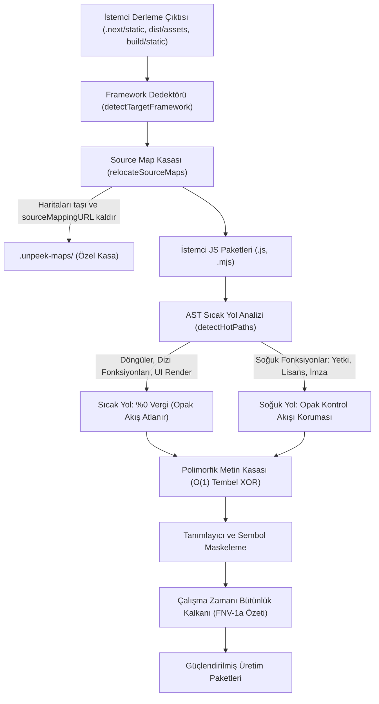

# unpeek

**Sıfır yapılandırma gerektiren, çağrı grafiği (call-graph) farkındalıklı, <%2 CPU ek yüküne sahip polimorfik JavaScript koruma ve çalışma zamanı (runtime) müdahale önleme aracı.**

[](LICENSE)
[](packages/unpeek/benchmarks/overhead.bench.ts)
[](packages/unpeek/benchmarks/overhead.bench.ts)
[](https://woffluon.github.io/unpeek)

[English](./README.md) | Türkçe · [Canlı İnteraktif Playground](https://woffluon.github.io/unpeek) · [Ajan Mimari Kılavuzu](./AGENTS.md) · [Yapay Zeka Becerisi (SKILL.md)](./skills/unpeek/SKILL.md)

---

## Neden unpeek?

Next.js, Vite veya Webpack ile geliştirilen modern bir web uygulamasını yayına aldığınızda; istemci tarafındaki iş mantığı, iç API uç noktaları, özellik bayrakları (feature flags) ve algoritmalar Chrome DevTools veya `webcrack` / `synchrony` gibi otomatik AST çözücüler aracılığıyla açıkça okunabilir.

Mevcut araçlar geliştiricileri zor bir ödünleşime zorlar:
- **Standart küçültücüler (`esbuild`, `SWC`, `Terser`):** Yalnızca boşlukları siler ve değişken adlarını kısaltır. DevTools içerisindeki Pretty-Print (`{}`) düğmesine tek bir tıklamayla metin sabitleri, API adresleri ve kontrol akışı yeniden okunabilir hale gelir.
- **Geleneksel AST karmaşıklaştırıcılar (`javascript-obfuscator`):** Paketteki her fonksiyona ayrım gözetmeksizin ağır kontrol akışı düzleştirme (control-flow flattening), `eval` tuzakları ve dizi döndürme işlemleri uygular. Bu yaklaşım paket boyutunu %40 ile %300 oranında şişirir, V8 TurboFan JIT derleyicisinin 60fps arayüz döngülerindeki satır içi optimizasyonlarını bozar ve tarayıcıda donmalara yol açar.

`unpeek`, statik çağrı grafiği analizini derleme zamanı polimorfik şifreleme ile birleştirerek bu sorunu çözer:

| Yetenek | Standart Küçültücüler (`Terser` / `SWC`) | Geleneksel AST Karmaşıklaştırıcılar | `unpeek` |
| :--- | :--- | :--- | :--- |
| **Çalışma Zamanı CPU Ek Yükü** | ~%0 | %15 ile %85 (arayüz döngülerini yavaşlatır) | **< %2.0** (Çağrı Grafiği Hot-Path Muafiyeti) |
| **Gzip Paket Büyümesi** | %0 (Referans) | +%45 ile +%300 | **< %15** (O(1) Tembel Metin Kasası) |
| **Metin ve API Uç Noktası Şifreleme** | Pakette düz metin (plaintext) | Başlangıçta tam dizi çözme (yüksek CPU) | **Polimorfik XOR + O(1) Önbellekli Kasa** |
| **DevTools Pretty-Print (`{}`) Koruması** | Yok | `debugger` döngüleri (kolayca devre dışı bırakılır) | **`Function.prototype.toString()` FNV-1a Bütünlük Doğrulaması** |
| **Source Map Yalıtımı** | Manuel CI betikleri | Manuel yapılandırma | **Otomatik `.unpeek-maps/` Kasası + Yorum Temizliği** |
| **Statik Deobfuscator Direnci** | Yok | Sabit şablonlar (`webcrack` tarafından tanınır) | **Derleme Başına Polimorfik AST Tohumu (Seed)** |
| **SSR / Next.js Uyumluluğu** | Doğal | Sunucu hidrasyonunu (hydration) sıklıkla bozar | **Yalnızca İstemci Otomatik Tespiti + SSR Koruması** |

### Temel Mimari



1. **Çağrı Grafiği (Call-Graph) Hot-Path Muafiyeti (`<%2` CPU Bütçesi)**
   [`detectHotPaths`](packages/unpeek/src/ast/index.ts), tek bir AST düğümünü değiştirmeden önce dosyanın çağrı grafiğini tarar. Döngü içeren fonksiyonlar (`for`, `while`, `do-while`, `for-of`), dizi yüksek mertebe geri çağrıları (`.map`, `.filter`, `.reduce`, `.forEach`), `requestAnimationFrame` zamanlayıcıları ve React/UI bileşenleri (`useState`, `useEffect`, `createElement`) sıcak yol (hot path) olarak işaretlenir. `unpeek` tüm paketteki yerel tanımlayıcıları maskeler ve metin sabitlerini şifreler; opak kontrol akışı korumalarını ise yalnızca soğuk fonksiyonlara (lisans doğrulama, istek imzalama, yetki kontrolü gibi) enjekte eder. Sıcak döngülerdeki V8 JIT optimizasyonu doğal hızında çalışmayı sürdürür.
2. **O(1) Tembel Metin Kasası (Lazy String Vault, `<%15` Gzip Bütçesi)**
   Düz metin sabitleri (`minStringLength >= 4`), derleme zamanında 32-bitlik polimorfik bir tohum (seed) ile anahtarlanan XOR akış şifresiyle kodlanır. Sayfa açılışında tüm metinleri aynı anda çözmek yerine, enjekte edilen kasa yardımcısı her metni ilk erişildiğinde tembel (lazy) olarak çözer ve düz metin sonucunu kendi dizi hücresine önbellekler. Sonraki tüm okumalar doğrudan dizi indeksleme ile O(1) sürede tamamlanır.
3. **Öz-Savunmalı `Function.prototype.toString()` Bütünlük Kontrolü ve Pasif Caydırıcı**
   Bir analist korumalı bir dosyayı DevTools Pretty-Print (`{}`) ile biçimlendirdiğinde veya Sources panelinde bir koşulu değiştirdiğinde, biçimlendirilen kod `Function.prototype.toString()` çıktısını değiştirir. [`verifyCodeIntegrity`](packages/unpeek/src/runtime/index.ts), dokunulmamış küçültülmüş kodda sıfır yanlış pozitif oranıyla 32-bit FNV-1a özetini doğrular ve saldırganların doğrudan yamayabileceği ani bir çökme yerine kademeli durum bozulması (`deterrentMode: 'gradual'`) başlatır.
4. **Otomatik Source Map Kasası (`.unpeek-maps/`)**
   Üretim çıktısında `.js.map` dosyalarını bırakmak, orijinal TypeScript proje ağacınızın DevTools içinde birebir yeniden oluşturulmasına yol açar. [`protectProject`](packages/unpeek/src/cli/protect.ts), `.map` dosyalarını genel çıktı dizininden özel `.unpeek-maps/` klasörüne taşır ve tüm istemci paketlerinden `//# sourceMappingURL=` yorumlarını temizler. Böylece haritaları son kullanıcılara sunmadan Sentry veya Datadog gibi platformlara yükleyebilirsiniz.

---

## Hızlı Başlangıç

### 1. Proje Kurulumu (`npx unpeek init`)

Proje kök dizininizde (Next.js, Vite, Webpack veya yalın JS) başlatıcıyı çalıştırın:

```bash
npx unpeek init
```

Bu komut üç hazırlık adımını tamamlar:
1. `package.json` ve yapılandırma dosyalarından çatınızı (`nextjs`, `vite`, `webpack` veya `vanilla`) otomatik tespit eder.
2. Her üretim derlemesinin otomatik olarak korunması için `package.json` betiklerine `"postbuild": "unpeek protect"` satırını ekler.
3. Çıkarılan kaynak haritalarının (source maps) git geçmişine girmemesi için `.gitignore` dosyasına `.unpeek-maps/` dizinini ekler.

### 2. CLI Kullanımı (`unpeek protect`)

`unpeek` paketini geliştirme bağımlılığı olarak kurup CI/CD süreçlerinde veya yerel derlemelerde doğrudan çalıştırabilirsiniz:

```bash
npm install -D unpeek
npx unpeek protect
```

#### CLI Komutları ve Seçenekleri

| Komut / Bayrak | Açıklama | Varsayılan |
| :--- | :--- | :--- |
| `init [--dry-run]` | Proje çerçevesini otomatik algılar, `postbuild` kancasını ve `.unpeek-maps/` kasasını yapılandırır | |
| `protect` | Üretim istemci paketlerini yerinde korur (varsayılan komut) | |
| `--out-dir <yol>` | İstemci çıktı klasörünü açıkça belirtir (ör. `dist/assets`, `.next/static/chunks`) | Proje framework'ünden otomatik tespit |
| `--seed <sayı>` | Deterministik 32-bit polimorfik derleme tohumu (seed) | Derleme başına rastgele |
| `--passive` | Kademeli bozulma yerine pasif telemetri caydırıcı modunu kullan | Varsayılan: kademeli bozulma (`gradual`) |
| `--no-maps` | `.map` dosyalarını `.unpeek-maps/` klasörüne taşımak yerine kalıcı olarak sil | `.unpeek-maps/` içine taşır |
| `--min-string-length <sayı>` | Tembel şifreleme kasasına alınacak minimum metin uzunluğu | `4` |
| `--private-maps-dir <dizin>` | Kaynak haritalarının taşınacağı özel kasa klasörü | `.unpeek-maps` |
| `--no-shield` | Çalışma zamanı anti-tamper kalkanının enjekte edilmesini devre dışı bırak | Giriş paketlerine kalkan eklenir |
| `-h, --help` | Yardım iletisini göster | |
| `-v, --version` | Sürüm numarasını göster | |

> [!NOTE]
> `protectProject(options)` üzerinden programatik kullanım; `minStringLength`, `privateMapsDir`, `injectRuntimeShield` ve `cwd` gibi ek yapılandırma seçeneklerini destekler.

> [!IMPORTANT]
> **CommonJS Kullanıcıları İçin Dinamik `import()` Uyarısı:**
> `unpeek` varsayılan olarak yerel ECMAScript Modülleri (`"type": "module"`) ile dağıtılmaktadır. CommonJS kullanan projelerde (`require()` veya `.cjs` yapılandırma dosyaları) `unpeek` modüllerini dinamik `import()` ile yükleyiniz:
> ```javascript
> // CommonJS (next.config.js / webpack.config.js / betikler)
> const unpeek = (await import('unpeek/unplugin')).default;
> const { protectProject, transformJavaScript } = await import('unpeek');
> ```

### 3. Evrensel Paketleyici Eklentisi (`unpeek/unplugin`)

Derleme sonrası CLI adımı yerine paketleyicinin `renderChunk` yaşam döngüsü sırasında bellek içi dönüşüm yapmak isterseniz [`unpeek/unplugin`](packages/unpeek/src/bundler/unplugin.ts) modülünü kullanabilirsiniz:

#### Vite (`vite.config.ts`)

```ts
import { defineConfig } from 'vite';
import unpeek from 'unpeek/unplugin';

export default defineConfig({
  plugins: [
    unpeek.vite({
      deterrentMode: 'gradual',
    }),
  ],
});
```

#### Next.js (`next.config.mjs`)

Node.js sunucu paketlerinin özgün yığın izlerini (stack traces) koruması için eklentiyi istemci paketleriyle (`!isServer`) sınırlandırın:

```js
import unpeek from 'unpeek/unplugin';

/** @type {import('next').NextConfig} */
const nextConfig = {
  webpack(config, { dev, isServer }) {
    if (!dev && !isServer) {
      config.plugins.push(
        unpeek.webpack({
          deterrentMode: 'gradual',
        })
      );
    }
    return config;
  },
};

export default nextConfig;
```

#### Programatik API

```ts
import { transformJavaScript, protectProject } from 'unpeek';

// Tek bir JavaScript kod dizesini bellek içinde dönüştürün
const result = transformJavaScript(sourceCode, {
  seed: 0x7f3a91,
  minStringLength: 4,
  injectRuntimeShield: true,
  deterrentMode: 'gradual',
});

console.log(result.hotPathReport);
// { totalFunctions: 12, hotFunctionsSkipped: ['renderLoop'], coldFunctionsProtected: ['signRequest'] }

// Veya tüm derleme dizinini koruyun
const summary = await protectProject({
  cwd: process.cwd(),
  keepPrivateMaps: true,
  privateMapsDir: '.unpeek-maps',
});
```

---

## `.unpeek-maps/` Source Map Kasası ve Sentry İş Akışı

`keepPrivateMaps` etkinleştirildiğinde (varsayılan), `unpeek` genel çıktı dizininizdeki tüm `.js.map` dosyalarını göreli dosya adlarını koruyarak `.unpeek-maps/` dizinine taşır ve genel `.js` dosyalarından `//# sourceMappingURL=` yönergelerini temizler.

Üretim hata izleme sistemlerinde tam yığın izi çözümlemesini (symbolication) korumak için:

```bash
# 1. Uygulamanızı derleyin ve unpeek'i çalıştırın (postbuild ile otomatik tetiklenir)
npm run build

# 2. .unpeek-maps/ klasöründeki gizli kaynak haritalarını Sentry veya Datadog'a yükleyin
npx @sentry/cli sourcemaps upload .unpeek-maps --release="$GIT_COMMIT_SHA"

# 3. Genel derleme klasörünüzü (.next/, dist/ veya build/) dağıtın
```

---

## Resmi Yapay Zeka Ajan Becerisi (Skill) Kurulumu

`unpeek`, Ajan Becerileri Keşif Optimizasyonu (SDO) standartlarını izleyen resmi ve belirteç optimizasyonlu bir Yapay Zeka Becerisi ([`skills/unpeek/SKILL.md`](skills/unpeek/SKILL.md)) sunar. Bu beceriyi eklemek; kodlama ajanınıza (Claude Code, Cursor, Antigravity, OpenAI Codex veya Gemini CLI) `unpeek` yapılandırmasını, SSR paketlerinin korunmasını ve `.unpeek-maps/` kasasının CI/CD hatlarına bağlanmasını öğretir.

### Proje Kapsamında Kurulum (Git ile Takımla Paylaşılır)

Beceriyi deponuzun `.agents/skills/unpeek/` dizinine kopyalayın:

```bash
mkdir -p .agents/skills/unpeek
curl -fsSL https://raw.githubusercontent.com/Woffluon/unpeek/main/skills/unpeek/SKILL.md \
  -o .agents/skills/unpeek/SKILL.md
```

### Genel Makine Kurulumu (Antigravity / Gemini CLI / Claude Code)

```bash
# Antigravity & Gemini CLI
mkdir -p ~/.gemini/config/skills/unpeek
curl -fsSL https://raw.githubusercontent.com/Woffluon/unpeek/main/skills/unpeek/SKILL.md \
  -o ~/.gemini/config/skills/unpeek/SKILL.md

# Ajanlar arası standart (~/.agents/skills)
mkdir -p ~/.agents/skills/unpeek
curl -fsSL https://raw.githubusercontent.com/Woffluon/unpeek/main/skills/unpeek/SKILL.md \
  -o ~/.agents/skills/unpeek/SKILL.md
```

---

## Doğrulama, Testler ve Benchmarklar

Bu monorepo `pnpm` ile yönetilir; semantik denklik, çözücü direnci ve çalışma zamanı ek yük bütçeleri doğrulanır:

```bash
# Çalışma alanı bağımlılıklarını kurun
pnpm install

# Birim ve tersine mühendislik direnç testlerini çalıştırın (Vitest)
pnpm test

# V8 kod kapsamı raporu ile birim testlerini çalıştırın
pnpm --filter unpeek run test:coverage

# V8 VM CPU ek yükü (<%2) ve Gzip artışı (<%15) benchmark testini çalıştırın
pnpm bench

# packages/unpeek ve apps/web genelinde katı TypeScript tip kontrolü yapın
pnpm typecheck

# Çekirdek paketi ve statik interaktif web arayüzünü derleyin
pnpm build
```

### Monorepo Betikleri ve Sürüm Bütünlüğü

```bash
# Conventional Commit sürüm hesaplamasını test edin
powershell -File scripts/test-versioning.ps1

# Planlanan commit ile sürüm uygunluğunu doğrulayın
powershell -File scripts/validate-version.ps1 -Message "fix: description"

# Sürüm paketlerini ve SHA-256 manifestlerini hazırlayın
powershell -File scripts/stage-release.ps1
```

### Benchmark Çıktı Referansı ([`packages/unpeek/benchmarks/overhead.bench.ts`](packages/unpeek/benchmarks/overhead.bench.ts))

- **Derleme / Dönüşüm Süresi:** `< 3000 ms`
- **Gzip Boyut Artışı:** `< %15` (üretim uygulama paketlerinde)
- **Çalışma Zamanı CPU Ek Yükü:** `< %2.00` (aralıklı çok turlu V8 JIT testi)
- **Düz Metin Sızıntı Oranı:** `%0` (`minStringLength` kuralını karşılayan metin sabitleri için)

## Lisans

[MIT Lisansı](./LICENSE) kapsamında yayınlanmıştır.
