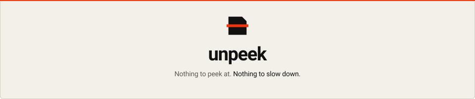
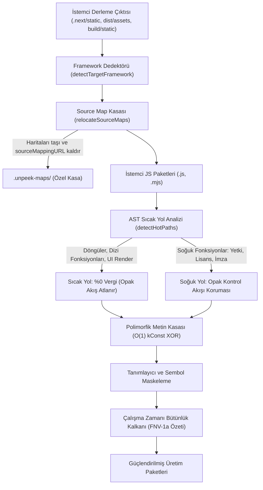

<p align="center">
  <picture>
    <source media="(prefers-color-scheme: dark)" srcset="https://raw.githubusercontent.com/Woffluon/unpeek/main/assets/banner-dark.svg">
    <source media="(prefers-color-scheme: light)" srcset="https://raw.githubusercontent.com/Woffluon/unpeek/main/assets/banner-light.svg">
    
  </picture>
</p>

# unpeek

**Bakılacak bir şey yok. Yavaşlayacak hiçbir şey yok.**

Sıfır yapılandırma gerektiren, çağrı grafiği (call-graph) farkındalıklı, <%2 CPU ek yükü ve <%15 Gzip bütçesine sahip istemci tarafı JavaScript koruma ve çalışma zamanı (runtime) müdahale önleme aracı.

[](LICENSE)
[](packages/unpeek/benchmarks/overhead.bench.ts)
[](packages/unpeek/benchmarks/overhead.bench.ts)
[](https://woffluon.github.io/unpeek)
[](https://woffluon.github.io/unpeek/docs)

[English](./README.md) | Türkçe · [İnteraktif Vitrin](https://woffluon.github.io/unpeek) · [Dokümantasyon](https://woffluon.github.io/unpeek/docs) · [Ajan Mimari Kılavuzu](./AGENTS.md) · [Yapay Zeka Becerisi (SKILL.md)](./skills/unpeek/SKILL.md)

---

## Neden unpeek?

Next.js, Vite veya Webpack ile geliştirilen modern bir web uygulamasını yayına aldığınızda; istemci tarafındaki iş mantığı, iç API uç noktaları, özellik bayrakları (feature flags) ve algoritmalar Chrome DevTools veya `webcrack` / `synchrony` gibi otomatik AST çözücüler aracılığıyla açıkça okunabilir.

Mevcut araçlar geliştiricileri zor bir ödünleşime zorlar:
- **Standart küçültücüler (`esbuild`, `SWC`, `Terser`):** Yalnızca boşlukları siler ve değişken adlarını kısaltır. DevTools içerisindeki Pretty-Print (`{}`) düğmesine tek bir tıklamayla metin sabitleri, API adresleri ve kontrol akışı yeniden okunabilir hale gelir.
- **Geleneksel AST karmaşıklaştırıcılar (`javascript-obfuscator`):** Paketteki her fonksiyona ayrım gözetmeksizin ağır kontrol akışı düzleştirme (control-flow flattening), `eval` tuzakları ve dizi döndürme işlemleri uygular. Bu yaklaşım paket boyutunu %40 ile %300 oranında şişirir, V8 TurboFan JIT derleyicisinin 60fps arayüz döngülerindeki satır içi optimizasyonlarını bozar ve tarayıcıda donmalara yol açar.

`unpeek`, statik çağrı grafiği analizini derleme zamanı polimorfik şifreleme ile birleştirerek bu sorunu çözer:

| Yetenek | Standart Küçültücüler (`Terser` / `SWC`) | Geleneksel AST Karmaşıklaştırıcılar | `unpeek` |
| :--- | :--- | :--- | :--- |
| **Çalışma Zamanı CPU Ek Yükü** | ~%0 | %15 ile %85 (arayüz döngülerini yavaşlatır) | **< %2.0** (Çağrı Grafiği Hot-Path Muafiyeti) |
| **Gzip Paket Büyümesi** | %0 (Referans) | +%45 ile +%300 | **< %15** (O(1) `kConst` Sabit-Dizi Metin Kasası) |
| **Metin ve API Uç Noktası Şifreleme** | Pakette düz metin (plaintext) | Başlangıçta tam dizi çözme (yüksek CPU) | **Polimorfik Periyot-2 XOR + O(1) `kConst` Kasa** |
| **DevTools Pretty-Print (`{}`) Koruması** | Yok | `debugger` döngüleri (kolayca devre dışı bırakılır) | **`Function.prototype.toString()` FNV-1a Bütünlük Doğrulaması** |
| **Source Map Yalıtımı** | Manuel CI betikleri | Manuel yapılandırma | **Otomatik `.unpeek-maps/` Kasası + Yorum Temizliği** |
| **Statik Deobfuscator Direnci** | Yok | Sabit şablonlar (`webcrack` tarafından tanınır) | **Derleme Başına Polimorfik AST Tohumu (Seed)** |
| **SSR / Next.js Uyumluluğu** | Doğal | Sunucu hidrasyonunu (hydration) sıklıkla bozar | **Yalnızca İstemci Otomatik Tespiti + SSR Koruması** |

### Temel Mimari



1. **Çağrı Grafiği (Call-Graph) Hot-Path Muafiyeti (`<%2` CPU Bütçesi)**
   [`detectHotPaths`](packages/unpeek/src/ast/index.ts), tek bir AST düğümünü değiştirmeden önce dosyanın çağrı grafiğini çift yönlü tarar. Döngü içeren fonksiyonlar (`for`, `while`, `do-while`, `for-of`), dizi yüksek mertebe geri çağrıları (`.map`, `.filter`, `.reduce`, `.forEach`), `requestAnimationFrame` zamanlayıcıları, React/UI bileşenleri (JSX `createElement`/`_jsx` veya `use*` kanca/HOC UI sinyali taşıyan PascalCase bileşenler) ve sıcak döngülerden çağrılan tüm yardımcı fonksiyonlar sıcak yol (hot path) olarak işaretlenir. `unpeek` sıcak döngüleri ve yardımcılarını hem opak kontrol akışı korumalarından hem de metin kasası dönüşümünden muaf tutar; korumayı yalnızca soğuk fonksiyonlara (lisans doğrulama, istek imzalama, yetki kontrolü gibi) uygular. Source Map v3 `sourcesContent`/`names` ve VLQ eşlemeleri (`sourcemap-critical.ts`), paketleyiciler yorumları temizlediğinde veya sembolleri yeniden adlandırdığında bile `/*! @unpeek-critical */` ve `critical.include` hedeflemesini korur. Sıcak döngülerdeki V8 JIT optimizasyonu doğal hızında çalışmayı sürdürür.
2. **O(1) Sabit-Dizi ve 64-Bit Tuzlu Metin Kasaları (`<%15` Gzip Bütçesi)**
   Soğuk metin sabitleri (`minStringLength >= 4`), enterpolasyonlu `TemplateLiteral` ifadelerindeki statik metin parçaları (`ToPrimitive("string")` sırası korunarak; etiketli şablonlar, dinamik `import()` ve sıcak yollar muaf tutulur) ve sır taşıyan `RegExp` değişmezleri `new RegExp(vault(...), flags)` biçiminde (döngüler ve `RegExp`-gölgeli/`with` kapsamları dışında), 92 karakterli kaçışsız involutory ASCII permütasyonu (`P[P[c]] = c`) veya paylaşımlı tekil `<1.2 KB` konak-bağlı WASM KDF (`deriveWasmAbiNames` polimorfik 2–3 karakterli içe/dışa aktarım ABI'si ve `<512 B` içinde karıştırılmış export sırası, maskeli `gMask`/`pcMask` konak içe aktarımları ve bit-özdeş non-lineer Rivest + S-Box JS yedeği ile) destekli 64-bit çağrı-noktası tuzlu çözücülerle (`computeCallSiteSalt64`) kodlanır; hem Tier 2 (`recommended`) hem Tier 3 (`strict` / `--aggressive`) modlarında kalkanla eşleşen (shield-coupled) ve yerinde yeniden şifrelenen `Uint8Array` + `TextDecoder` Shader Kasası uygulanır. Evrensel ikili/Base64 WASM yükleri (`AGFzbQE`), ikili `data:` URI'ları ve büyük saf Base64 blokları çift kodlamaya karşı kasalardan muaf tutulur. `sv === void 0` için asenkron tolerans yalnızca yüklenmekte olan gerçek DOM (`document.scripts.length > 0 && document.readyState !== 'complete'`) veya Web Worker (`self.importScripts`) bağlamlarıyla sınırlandırılır ve önbelleği zehirlemeden (`d = -1` kaldırıldı) çözülür; çıplak tarayıcı-dışı VM bağlamları (`node:vm`, boş `{}`), kalkanı eksik tamamlanmış belgeler ve aktif kurcalamalar önbelleğe yazmadan kapalı başarısız olur.
3. **Sıra-Bağımsız `globalThis` Kalkanı, Non-Lineer MBA ve Tier 3 Micro-VM v2**
   Giriş paketleri, `WorkerGlobalScope` uyumlu (`self`/`globalThis`, tek satır `<2.3 KB`) sıra-bağımsız bir bütünlük IIFE'i enjekte eder; [`verifyCodeIntegrity`](packages/unpeek/src/runtime/index.ts) ile `Function.prototype.toString()`, `Reflect.apply`, `Error.prepareStackTrace` ve `Error.prototype.stack` tanımlayıcı, imza, çapraz çağrı ve yığın izi `Proxy` tuzaklarını yakalar ve `detectHeadless: true` etkinleştirildiğinde `navigator.webdriver`, `HeadlessChrome`, `__playwright`, `__puppeteer_evaluation_script__`, `__nightmare`, `frida` ve `_frida_` işaretçilerini senkron denetler. Soğuk yollar (`coldFlow: true`), tip korumalı `>=4`-değişkenli yarı-lineer MBA + 6 durum-, kalkan- ve alan-bağlı koşul biçimi (Form 4 işaretsiz-alan MBA eşitsizliği ve `modInverseUint32` tabanlı Form 5 parametrik afin ters MBA özdeşliği dahil) ve 4 modüler rezidü ailesi ($\pmod 4, \pmod 8, \pmod{16}$) üzerinde sabit `=== R` soneki barındırmayan derece-3 Rivest $\mathbb{Z}_{2^{32}}$ QNR koşulları, alias tablosu karıştırması ve nötr tuzak köprüleri alır; Tier 3 / `--aggressive`, soğuk yoldaki `^`/`|`/`&` bit düzeyinde işlemleri parametrik afin MBA ile değiştirir (`applyColdBitwiseMba`, parça başına en fazla 8, `BigInt`/`with`/`Math` gölgeleme korumalı) ve `@unpeek-critical` ile kritik form/doğrulama işleyicilerini öncelik sırasıyla `globalThis` üzerinde paylaşılan 43-komutlu direct-threaded Micro-VM v2 motoruna (`$step` trambolini, bloklar arası `$f.ac` çarkı, sıfır-olmayan opcode başına semantik handler sapmaları `1..31`, 32-bit `sym_s[1]` doğrulaması, `_uVm*` öz-karması ve sıfır `eval()`) taşır. Verilen tepki `deterrentMode` ile yönetilir:
   - `passive` (hem CLI `protect` hem de `unplugin` varsayılanı): Konsol çıktısını susturmadan veya uygulamayı çökertmeden `self`/`globalThis` üzerine bir telemetri olayı (`unpeek:tamper`) iletir; tersine mühendislik girişimlerinin sessizce izlenmesini sağlar.
   - `gradual` (`--gradual` veya `deterrentMode: 'gradual'` ile seçime bağlı): İç çalışma zamanı çözümlemelerini kademeli olarak bozar ve `console` çıktılarını susturur; saldırganların doğrudan yamayabileceği ani bir hata yığın izi üretmeden kodu işlevsizleştirir.
4. **Çok Geçişli Source Map Kasası (`.unpeek-maps/`) ve Otomatik SHA-256 `debugId`**
   Üretim çıktısında `.js.map` dosyalarını bırakmak, orijinal TypeScript proje ağacınızın DevTools içinde birebir yeniden oluşturulmasına yol açar. [`protectProject`](packages/unpeek/src/core/protect.ts), ECMA-426 `.sections` indeks haritalarını düzleştirir, çok geçişli $M_1 \circ M_2$ VLQ bileşimini (`chainSourceMaps`) hesaplar, `keepPrivateMaps: true` iken (önceden `debugId` bulunmasa bile) JS paketine ve kasadaki `.map` dosyasına otomatik olarak aynı deterministik SHA-256 `debugId` imzasını işler (`unpeek check` ile doğrulanır), `.map` dosyalarını `.unpeek-maps/` klasörüne taşır ve `//# sourceMappingURL=` yorumlarını temizler.

---

## Hızlı Başlangıç

### 1. Proje Kurulumu (`npx unpeek init`)

Proje kök dizininizde (Next.js, Vite, Webpack veya yalın JS) başlatıcıyı çalıştırın:

```bash
npx unpeek init
```

Bu komut üç hazırlık adımını tamamlar:
1. `package.json` ve yapılandırma dosyalarından çatınızı (`nextjs`, `vite`, `webpack` veya `vanilla`) otomatik tespit eder.
2. **Next.js >= 16.2** projelerinde `next.config.*` dosyasına `unpeek/next` içinden `withUnpeek` Build Adapter sarmalayıcısını otomatik bağlar (koruma `postbuild` betiği olmadan `onBuildComplete` içinde çalışır); diğer tüm çatılarda (Next.js < 16.2 dahil) `package.json` betiklerine `"postbuild": "unpeek protect"` satırını ekler.
3. Çıkarılan kaynak haritalarının (source maps) git geçmişine girmemesi için `.gitignore` dosyasına `.unpeek-maps/` dizinini ekler.

### 2. CLI Kullanımı (`unpeek protect`)

`unpeek` paketini geliştirme bağımlılığı olarak kurup CI/CD süreçlerinde veya yerel derlemelerde doğrudan çalıştırabilirsiniz:

```bash
npm install -D unpeek
npx unpeek protect
```

#### CLI Komutları ve Seçenekleri

| Komut / Bayrak | Açıklama | Varsayılan |
| :--- | :--- | :--- |
| `init [--dry-run] [--profile <ad>]` | Proje çerçevesini otomatik algılar, `postbuild` kancasını ve `.unpeek-maps/` kasasını yapılandırır | |
| `protect` | Üretim istemci paketlerini yerinde korur (varsayılan komut) | |
| `check` | Sızan `.map` dosyaları, `sourceMappingURL` yorumları, yoksayma kuralları, Gzip bütçesi, `eval()`, `debugId` bütünlüğü ve Acorn AST `'plaintext-secret'` uyarıları için salt okunur CI kapısı (`--require-zero-eval` koruma öncesi taban çizgisi, `node_modules/` kaynak haritası ve `Function("return this")` kalıplarını uyarıda tutar; `CheckOptions.failOnPlaintextSecrets: true` gizli bulguları hataya yükseltir) | |
| `symbolicate` | `.unpeek-maps/` kullanarak üretim yığın izlerini (stack traces) yerelde çözümler (`--maps-dir`, `--trace`, `--file`) | |
| `--profile <ad>` | Hazır koruma profili: `minimal`, `recommended` veya `strict` | |
| `--dry-run` | Dosyalara yazmadan bellek içinde dönüşüm ve Gzip farkını hesaplar | Kapalı |
| `--max-gzip-delta <sayı>` | Gzip artışı belirtilen yüzdeyi aşarsa hata verir (`protect` / `check`) | `15` (`check` için) |
| `--require-zero-eval` | Atfedilemeyen veya koruma sonrası eklenen `eval()` / `new Function()` çağrılarında `check` komutunu başarısız kılar | Kapalı |
| `--out-dir <yol>` | İstemci çıktı klasörünü açıkça belirtir (ör. `dist/assets`, `.next/static/chunks`) | Proje framework'ünden otomatik tespit |
| `--seed <sayı>` | Deterministik 32-bit polimorfik derleme tohumu (seed) | Derleme başına rastgele |
| `--aggressive` | Katman 3 (Tier 3) agresif korumayı etkinleştirir (Micro-VM v2, tekil WASM KDF, tuzlu kasa ve Shader Kasası) | Varsayılan: kapalı (Tier 2 recommended varsayılanı: <%2 CPU, <%15 Gzip) |
| `--passive` | Pasif caydırıcı modunu kullanır (konsol sessize alma olmadan yalnızca telemetri olayı) | Varsayılan (`passive`) |
| `--gradual` | Kademeli caydırıcı modunu kullanır (kurcalamada `console` çıktılarını susturur ve çalışma zamanını bozar) | Kapalı |
| `--detect-headless` | `navigator.webdriver`, `HeadlessChrome`, `__playwright`, `__puppeteer_evaluation_script__`, `__nightmare`, `frida` ve `_frida_` işaretçilerini kurcalama olarak işaretler | Kapalı |
| `--no-maps` | `.map` dosyalarını `.unpeek-maps/` klasörüne taşımak yerine kalıcı olarak sil | `.unpeek-maps/` içine taşır |
| `--min-string-length <sayı>` | O(1) `kConst` şifreleme kasasına alınacak minimum metin uzunluğu | `4` |
| `--private-maps-dir <dizin>` | Kaynak haritalarının taşınacağı özel kasa klasörü | `.unpeek-maps` |
| `--no-shield` | Çalışma zamanı anti-tamper kalkanının enjekte edilmesini devre dışı bırak | Giriş paketlerine kalkan eklenir |
| `-h, --help` | Yardım iletisini göster | |
| `-v, --version` | Sürüm numarasını göster | |

> [!NOTE]
> **Koruma Katmanları ve Profiller:**
> - **Tier 1 (`--profile minimal`):** Çağrı grafiği sıcak yol muafiyeti (`coldFlow: false`), `mangler.minLength: 1` ve sıra-bağımsız `globalThis` kalkanı (<%2 CPU, <%15 Gzip bütçesi).
> - **Tier 2 (`--profile recommended` / Varsayılan):** 92-karakter kaçışsız metin kasası (enterpolasyonlu `TemplateLiteral` statik parçaları ve sır taşıyan `RegExp` değişmezleri dahil), `>=4`-değişkenli yarı-lineer MBA + derece-3 Rivest QNR ile Form 4/5 işaretsiz/afin ters MBA koruyucuları ve yerinde şifrelenen `Uint8Array` shader kasası ekler.
> - **Tier 3 (`--profile strict` / `--aggressive`):** `@unpeek-critical` fonksiyonlarını ve `critical.include` desenlerini 43-komutlu direct-threaded Micro-VM v2, paylaşımlı `<1.2 KB` konak-bağlı WASM KDF (`deriveWasmAbiNames` polimorfik ABI + karıştırılmış export sırası `<512 B`, bit-özdeş JS yedeğiyle), 64-bit çağrı-noktası tuzlu kasa, soğuk-yol `^`/`|`/`&` afin bit düzeyinde MBA (`applyColdBitwiseMba`, parça başına en fazla 8) ve CWE-540 yol temizliğiyle korur.
>
> `protectProject(options)` üzerinden programatik kullanım; `tier`, `critical`, `seed`, `minStringLength`, `privateMapsDir`, `injectRuntimeShield`, `deterrentMode`, `detectHeadless`, `aggressive`, `scrubPaths` ve `cwd` seçeneklerini destekler; `checkProject(options)` ayrıca Shannon entropi, İngilizce bigram süzgeci ve maskelenmiş önizlemeli `'plaintext-secret'` AST denetimi için `failOnPlaintextSecrets` (`boolean`, varsayılan `false` -> `'warning'`) seçeneğini sunar; `unpeek protect` özet çıktısında efektif `tier` (`Tier 1`/`Tier 2`/`Tier 3`) ve `shield` (`deterrentMode` ile `detectHeadless`) satırlarını raporlar. Paketleyici eklentileri küçültme sonrası aşamalarda çalışır (Vite `enforce: 'post'` `generateBundle` + `worker.plugins`, Webpack/Rspack `processAssets`, esbuild `onEnd`, Rollup `renderChunk`, Next.js `.next/build-manifest.json`), Service Worker ve Web Worker dosyaları (`sw.js`, `*.worker.js`) `target: 'worker'` belirtilmedikçe varsayılan olarak ayrı tutulur.

> [!IMPORTANT]
> **Yerel CommonJS & ESM Çift-Paket Desteği:**
> `unpeek` ve tüm alt yolları (`unpeek/vite`, `unpeek/webpack`, `unpeek/rollup`, `unpeek/esbuild`, `unpeek/rspack`, `unpeek/unplugin`, `unpeek/next`, `unpeek/config`, `unpeek/browser`, `unpeek/package.json`) hem ESM `import` hem de CommonJS `require(...)` sözdizimini yerel olarak destekler. Paketleyici alt yolları CJS içinde doğrudan `default` dışa aktarımını sunar:
> ```javascript
> // CommonJS (next.config.js / webpack.config.cjs / betikler)
> const unpeek = require('unpeek/vite');
> const { withUnpeek } = require('unpeek/next');
> const { protectProject, transformJavaScript } = require('unpeek');
> ```

### 3. Evrensel Paketleyici Eklentisi (`unpeek/unplugin`)

Derleme sonrası CLI adımı yerine paketleyicinin `renderChunk` yaşam döngüsü sırasında bellek içi dönüşüm yapmak isterseniz [`unpeek/unplugin`](packages/unpeek/src/plugins/unplugin.ts) modülünü veya doğrudan ilgili alt yolu (`unpeek/vite`, `unpeek/webpack`, `unpeek/rollup`, `unpeek/esbuild`, `unpeek/rspack`) kullanabilirsiniz:

#### Vite (`vite.config.ts`)

```ts
import { defineConfig } from 'vite';
import unpeek from 'unpeek/vite';

export default defineConfig({
  plugins: [
    unpeek({
      deterrentMode: 'passive',
    }),
  ],
});
```

#### Next.js (`next.config.mjs`)

**Next.js >= 16.2** için `unpeek/next` alt yolundan `withUnpeek` Build Adapter yardımcısını kullanın (`npx unpeek init` tarafından otomatik bağlanır). `withUnpeek` / `createUnpeekNextAdapter` üretim derlemelerinde Vercel değişmez chunk hash çakışmalarını önlemek için deterministik `outputHashSalt` enjekte eder, `TURBOPACK.push` başlıklarını seçici olarak muaf tutarken modül fabrika gövdelerini şifreler ve `.next/static` boş olduğunda `.vercel/output/static/_next/static` çıktı dizinini otomatik algılar:

```js
import { withUnpeek } from 'unpeek/next';

/** @type {import('next').NextConfig} */
const nextConfig = {};

export default withUnpeek(nextConfig);
```

> [!WARNING]
> **Yalnızca Güvenilir Ortamlarda Kullanın (`upstreamAdapterPath`):**
> `withUnpeek` / `createUnpeekNextAdapter`, `upstreamAdapterPath` veya `UNPEEK_UPSTREAM_ADAPTER_PATH` üzerinden mevcut bir adaptörü zincirlemeyi destekler ve bu modülü derleme zamanında dinamik olarak içe aktarır. `upstreamAdapterPath` veya `UNPEEK_UPSTREAM_ADAPTER_PATH` değerini yalnızca güvenilir proje bağlamlarında ayarlayın.

Next.js < 16.2 Webpack derlemelerinde Node.js sunucu paketlerinin özgün yığın izlerini (stack traces) koruması için eklentiyi istemci paketleriyle (`!isServer`) sınırlandırın:

```js
import unpeek from 'unpeek/webpack';

/** @type {import('next').NextConfig} */
const nextConfig = {
  webpack(config, { dev, isServer }) {
    if (!dev && !isServer) {
      config.plugins.push(
        unpeek({
          deterrentMode: 'passive',
        })
      );
    }
    return config;
  },
};

export default nextConfig;
```

#### Programatik API ve Paket Dışa Aktarımları (`3.0.0`)

`unpeek` 3.0.0 sürümünde kök `unpeek` giriş noktası temel üst düzey API'yi (`protectProject`, `transformJavaScript`, `initProject`, `checkProject`, `symbolicateStackTrace`, `PRESETS`, `defineConfig`, `loadUnpeekConfig`, `UnpeekError`, `isUnpeekError`, `UnpeekErrorCode` ve `UnpeekProfile`, `UnpeekDiagnostic`, `TransformResult` gibi genel TypeScript tipleri) sunar; paketleyici bağdaştırıcıları ve yapılandırma yardımcıları ise özel alt yollarda (`unpeek/config`, `unpeek/browser`, `unpeek/next`, `unpeek/vite`, `unpeek/webpack`, `unpeek/rollup`, `unpeek/esbuild`, `unpeek/rspack`, `unpeek/unplugin`, `unpeek/package.json`) yer alır. v2.x'ten geçiş ve kırıcı değişiklikler için [Geçiş Kılavuzu (v3.0.0)](docs/MIGRATION_V3.md) belgesine bakın.

```ts
import {
  PRESETS,
  transformJavaScript,
  protectProject,
  checkProject,
  symbolicateStackTrace,
  isUnpeekError,
} from 'unpeek';

try {
  // Tek bir JavaScript kod dizesini bellek içinde dönüştürün
  const result = transformJavaScript(sourceCode, {
    seed: 0x7f3a91,
    minStringLength: 4,
    injectRuntimeShield: true,
    deterrentMode: 'passive',
    scrubPaths: true,
  });

  if (result.skippedReason) {
    console.log('Atlandı:', result.skippedReason);
  }
  console.log(result.hotPathReport);
  // { totalFunctions: 12, hotFunctionsSkipped: ['renderLoop'], coldFunctionsProtected: ['signRequest'] }

  // Veya tüm derleme dizinini koruyun
  const summary = await protectProject({
    cwd: process.cwd(),
    profile: 'recommended',
    keepPrivateMaps: true,
    privateMapsDir: '.unpeek-maps',
  });
} catch (err) {
  if (isUnpeekError(err)) {
    // err.code bir UnpeekErrorCode değeridir (ör. 'ERR_CONFIG_INVALID', 'ERR_CONFIG_LOAD', 'ERR_PARSE_FAILED', 'ERR_BUDGET_EXCEEDED')
    console.error(err.code, err.message);
  }
  throw err;
}
```

---

## Yapılandırma Dosyası (`unpeek.config.js` / `.mjs` / `.cjs` / `.json`)

`unpeek`, proje kök dizinindeki özel bir yapılandırma dosyası (configuration file) aracılığıyla bildirimsel yapılandırmayı destekler. Hem CLI hem de paketleyici eklentileri (bundler plugins), yapılandırma dosyalarını şu öncelik sırasına göre otomatik olarak keşfeder:
1. `unpeek.config.js`
2. `unpeek.config.mjs`
3. `unpeek.config.cjs`
4. `unpeek.config.json`

### Tip Güvenli Yapılandırma (`defineConfig`)

IDE otomatik tamamlama ve TypeScript tip doğrulamasını etkinleştirmek için `'unpeek/config'` üzerinden (ayrıca `'unpeek'` kökünden de dışa aktarılır) `defineConfig` yardımcısını içe aktarın. Hatalı biçimlendirilmiş veya nesne olmayan yapılandırma dosyaları sessizce yoksayılmak yerine `UnpeekError` (`ERR_CONFIG_INVALID` veya `ERR_CONFIG_LOAD`) fırlatır:

```javascript
// unpeek.config.mjs (veya unpeek.config.js)
import { defineConfig } from 'unpeek/config';

export default defineConfig({
  // Hedef çatı geçersiz kılma ('nextjs' | 'vite' | 'webpack' | 'vanilla')
  framework: 'nextjs',

  // Hedef çalışma ortamı ('browser' | 'worker' | 'universal')
  target: 'browser',

  // Hazır koruma profili ('minimal' | 'recommended' | 'strict') ve katman ('Tier 1' | 'Tier 2' | 'Tier 3')
  profile: 'recommended',
  tier: 'Tier 2',
  // Opsiyonel deterministik 32-bit derleme tohumu (sonlu sayı)
  seed: 0x42f00d,
  coldFlow: true,

  // Tier 3 kritik bölge hedeflemesi (@unpeek-critical / include desenleri)
  critical: {
    annotation: '@unpeek-critical',
    maxFunctionsPerChunk: 12,
  },

  // İstemci çıktı dizini geçersiz kılma (belirtilmezse çatıdan otomatik algılanır)
  outDir: '.next/static/chunks',

  // Korumaya dahil edilecek derlenmiş JavaScript uzantıları (ham .ts/.tsx kaynakları CLI protect tarafından işlenmez)
  extensions: ['.js', '.mjs', '.cjs'],

  // Genel statik varlık dizinleri
  publicDirs: ['public', 'static'],

  // Dosya dahil etme ve hariç tutma glob filtreleri (CLI scanClientBundles ve unplugin içinde uygulanır)
  filter: {
    include: [],
    exclude: ['node_modules/**', '**/*.test.*', '**/*.spec.*'],
  },

  // Çağrı grafiği analizi ve sıcak yol (hot path) ince ayarları
  hotPath: {
    // Korumadan muaf tutulacak özel animasyon döngüsü ve zamanlayıcı fonksiyonları
    customAnimationCalls: ['requestAnimationFrame', 'ticker', 'renderLoop'],
    // UI render sınırı olarak ele alınacak özel React kancaları (hooks)
    customHooks: ['useAnimation', 'useCanvas'],
    // Sıcak döngü muamelesi görecek yüksek mertebe dizi fonksiyonları
    arrayHofMethods: ['map', 'filter', 'reduce', 'forEach'],
    // Sıcak yol muafiyeti için geçişken çağıran tarama derinliği (varsayılan: 2)
    maxPipelineCallers: 2,
    // AST dönüşümünden tamamen muaf tutulacak bileşen adları
    excludeComponents: ['VirtualTable', 'DataGrid'],
  },

  // Polimorfik metin kasası (string vault) yapılandırması
  vault: {
    // O(1) kConst dizisine şifrelenecek minimum metin uzunluğu (varsayılan: 4)
    minStringLength: 4,
    // CSS çatısı sınıf ayrıştırması ('tailwind' | 'unocss' | 'none')
    cssFramework: 'tailwind',
    // UI sınıf dizgilerini ve anlamsal DOM bağlayıcılarını koru
    semanticAnchors: {
      excludeUiClasses: true,
    },
    // Otomatik entropi tarayıcılarını yanıltmak için sahte metinler üret
    polymorphicDecoys: true,
    // Metin kasasını birden fazla parçaya böl ('strict' profilinde varsayılan olarak etkindir)
    fragmented: true,
    fragmentCount: 4,
  },
  // Yerel dosya sistemi yollarını ve artık geliştirme meta verilerini temizle (CWE-540)
  scrubPaths: true,

  // Tanımlayıcı ve sembol maskeleme (mangler) yapılandırması
  mangler: {
    // Maskelemeye tabi tutulacak en küçük yerel tanımlayıcı uzunluğu (varsayılan: 1)
    minLength: 1,
    // Maskelemeden muaf tutulacak üst düzey tanımlayıcılar
    reservedIdentifiers: ['__NEXT_DATA__', '__PRELOADED_STATE__'],
    // Korunacak özellik önekleri
    excludePrefixes: ['data-', 'aria-'],
    // Korunacak düzenli ifade (RegExp) desenleri
    excludePatterns: [/^on[A-Z]/],
  },

  // Çalışma zamanı anti-tamper kalkan seçenekleri
  shield: {
    deterrentMode: 'passive',
    detectHeadless: false,
  },

  // Özel kaynak haritası (source map) kasası seçenekleri
  sourcemaps: {
    // .map dosyalarını özel kasa dizinine taşı (varsayılan: true)
    keepPrivate: true,
    // Taşınan kaynak haritaları için özel dizin adı (varsayılan: '.unpeek-maps')
    vaultDir: '.unpeek-maps',
    // İstemci paketlerinden //# sourceMappingURL= yönergelerini temizle (varsayılan: true)
    stripComments: true,
  },

  // Next.js'e özgü geçersiz kılmalar
  next: {
    // Özel derleme çıktı dizini (varsayılan: '.next')
    distDir: '.next',
  },

  // Vite'a özgü geçersiz kılmalar
  vite: {
    // Çıktı dizini (varsayılan: 'dist')
    outDir: 'dist',
    // outDir içerisindeki varlıklar dizini (varsayılan: 'assets')
    assetsDir: 'assets',
  },
});
```

JSON formatındaki yapılandırmalar için (`unpeek.config.json`):

```json
{
  "framework": "nextjs",
  "target": "browser",
  "vault": {
    "minStringLength": 4,
    "cssFramework": "tailwind"
  },
  "sourcemaps": {
    "keepPrivate": true,
    "vaultDir": ".unpeek-maps"
  },
  "next": {
    "distDir": ".next"
  }
}
```

---

## `.unpeek-maps/` Source Map Kasası ve Sentry İş Akışı

`keepPrivateMaps` etkinleştirildiğinde (varsayılan), `unpeek` genel çıktı dizininizdeki tüm `.js.map` dosyalarını göreli dosya adlarını koruyarak `.unpeek-maps/` dizinine taşır, önceden `debugId` bulunmasa bile korumalı `.js` paketi ile kasadaki `.map` dosyasına otomatik olarak aynı deterministik SHA-256 `debugId` imzasını basar, paketleyiciler yorumları temizlediğinde `/*! @unpeek-critical */` hedeflerini Source Map v3 üzerinden çözümler ve genel `.js` dosyalarından `//# sourceMappingURL=` yönergelerini temizler.

> [!CAUTION]
> **Konteyner Güvenliği Uyarısı (`.dockerignore`):**
> Web uygulamalarınızı Docker ile paketlerken `.unpeek-maps/` dizininin `.dockerignore` dosyasına eklendiğinden emin olun. Eğer `.unpeek-maps/` atlanırsa, standart `COPY . .` komutları özel kaynak haritalarını yayınlanan konteyner imaj katmanına kopyalar ve imaja erişimi olan herkesin orijinal kaynak kodlarınızı elde etmesine yol açar. `unpeek` CLI, derleme sırasında `.dockerignore` dosyasını otomatik olarak denetler ve bu kayıt eksikse uyarı mesajı görüntüler.

Üretim hata izleme sistemlerinde tam yığın izi çözümlemesini (symbolication) korumak için:

```bash
# 1. Uygulamanızı derleyin ve unpeek'i çalıştırın (postbuild ile otomatik tetiklenir)
npm run build

# 2. .unpeek-maps/ klasöründeki gizli kaynak haritalarını Sentry veya Datadog'a yükleyin
npx @sentry/cli sourcemaps upload .unpeek-maps --release="$GIT_COMMIT_SHA"

# 3. Genel derleme klasörünüzü (.next/, dist/ veya build/) dağıtın
```

---

## Yapay Zeka Kodlama Ajanı Entegrasyonu (AI Coding Agent Integration)

`unpeek`, açık Vercel Agent Skills belirtimi ve Ajan Becerileri Keşif Optimizasyonu (SDO) standartlarıyla tam uyumlu resmi bir Yapay Zeka Ajan Becerisi ([`skills/unpeek/SKILL.md`](skills/unpeek/SKILL.md)) sunar. Bu beceriyi eklemek; kodlama ajanlarınıza (Claude Code, Cursor, OpenAI Codex, Gemini CLI, GitHub Copilot, OpenCode) istemci paketlerini koruma, hot-path performans bütçelerini (<%2 CPU, <%15 Gzip) koruma, SSR sınırlarını gözetme ve `.unpeek-maps/` kasasını CI/CD hatlarına bağlama konularında doğrudan operasyonel iş akışları kazandırır.

### Beceri (Skill) Kurulumu

#### 1. Standart Kurulum (Vercel Agent Skills CLI)

Beceriyi doğrudan GitHub üzerinden projenize veya yapılandırılmış ajan ortamınıza kurun:

```bash
npx skills add Woffluon/unpeek
```

#### 2. Yerel Depo Kurulumu

`unpeek` deposu içerisinde doğrudan geliştirme veya test yaparken:

```bash
npx skills add .
```

#### 3. Çoklu Ajan Hedefleme ve Global Kurulum

Etkileşimli onay istemlerini atlayarak birden çok kodlama ajanını global olarak hedefleyin:

```bash
npx skills add Woffluon/unpeek --agent claude-code codex cursor gemini-cli github-copilot opencode --global --yes
```

#### 4. Manuel / Doğrudan Kopyalama ile Kurulum

Beceriyi proje düzeyindeki veya genel ajan dizinlerine manuel olarak da indirebilirsiniz:

```bash
# Proje kapsamında (.agents/skills/unpeek/SKILL.md)
mkdir -p .agents/skills/unpeek
curl -fsSL https://raw.githubusercontent.com/Woffluon/unpeek/main/skills/unpeek/SKILL.md \
  -o .agents/skills/unpeek/SKILL.md

# Genel ajan dizinleri (Antigravity / Gemini CLI / Claude Code)
mkdir -p ~/.agents/skills/unpeek
curl -fsSL https://raw.githubusercontent.com/Woffluon/unpeek/main/skills/unpeek/SKILL.md \
  -o ~/.agents/skills/unpeek/SKILL.md
```

### Ajan Tetikleme Örneği (Prompt)

Kurulum tamamlandıktan sonra herhangi bir ajan oturumunda `$unpeek` istemiyle koruma sürecini başlatın:

```text
$unpeek Protect this build with passive telemetry and seed 0x7f4a2c.
```

### Token-Optimize Modüler Referans Yapısı (`skills/unpeek/references/`)

Ajan bağlam penceresini (context window) korumak ve gereksiz token tüketimini önlemek için ana [`skills/unpeek/SKILL.md`](skills/unpeek/SKILL.md) dosyası kompakt tutulmuş; detaylı rehberler `skills/unpeek/references/` dizini altındaki 6 modüler dokümana ayrılmıştır:

- **`quickstart.md`**: Sıfır ayarlı kurulum, postbuild betikleri ve 3 adımlı doğrulama döngüsü.
- **`frameworks.md`**: Çatı bazlı yapılandırmalar ve SSR istemci sınırları (Next.js, Vite, Webpack, Rollup).
- **`architecture.md`**: Acorn AST ayrıştırma, geçişken çağrı grafiği hot-path muafiyeti ve FNV-1a sağlama toplamları.
- **`sourcemaps.md`**: `.unpeek-maps/` kasa izolasyonu, CI hatları ve Sentry/Datadog sembol yükleme iş akışları.
- **`api.md`**: CLI bayrakları, programatik Node.js metotları (`protectProject`, `transformJavaScript`) ve TypeScript arayüzleri.
- **`recipes.md`**: Üretim zırhlama tarifleri, deterministik CI tohumları ve pasif telemetri sorun giderme adımları.

Ajanlar yalnızca o anki görevin gerektirdiği referans dosyasını seçici olarak okur; böylece bağlam şişmesi engellenir.

---

## Doğrulama, Testler ve Benchmarklar

Bu monorepo `pnpm` ile yönetilir; semantik denklik, çözücü direnci ve çalışma zamanı ek yük bütçeleri doğrulanır:

```bash
# Çalışma alanı bağımlılıklarını kurun
pnpm install

# Birim ve tersine mühendislik direnç testlerini çalıştırın (Vitest)
pnpm test

# V8 kod kapsamı raporu ile birim testlerini çalıştırın
pnpm --filter unpeek run test:coverage

# V8 VM CPU ek yükü (<%2) ve Gzip artışı (<%15) benchmark testini çalıştırın
pnpm bench

# packages/unpeek ve apps/web genelinde katı TypeScript tip kontrolü yapın
pnpm typecheck

# Çekirdek paketi ve statik interaktif web arayüzünü derleyin
pnpm build
```

### Monorepo Betikleri ve Sürüm Bütünlüğü

```bash
# Conventional Commit sürüm hesaplamasını test edin
powershell -File scripts/test-versioning.ps1

# Planlanan commit ile sürüm uygunluğunu doğrulayın
powershell -File scripts/validate-version.ps1 -Message "fix: description"

# Sürüm paketlerini ve SHA-256 manifestlerini hazırlayın
powershell -File scripts/stage-release.ps1
```

### Benchmark Çıktı Referansı ([`packages/unpeek/benchmarks/overhead.bench.ts`](packages/unpeek/benchmarks/overhead.bench.ts))

- **Derleme / Dönüşüm Süresi:** `< 3000 ms`
- **Gzip Boyut Artışı:** `< %15` (Tier 1 & Tier 2 üretim uygulama paketlerinde)
- **Çalışma Zamanı CPU Ek Yükü:** `< %2.00` (Tier 1 & Tier 2 sıcak yollarında eşleştirilmiş aralıklı çeyrekler arası ortalama)
- **Düz Metin Sızıntı Oranı:** `%0` (`minStringLength` kuralını karşılayan metin sabitleri için)

## Lisans

[MIT Lisansı](./LICENSE) kapsamında yayınlanmıştır.
